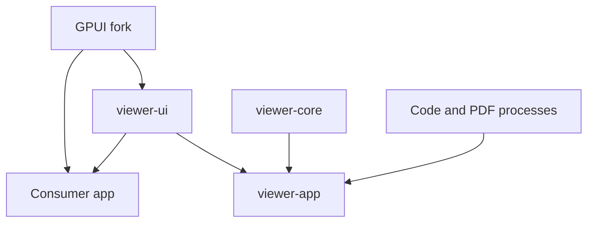

# TPUI Architecture

English | [한국어](docs-translate/ko/architecture.md)

TPUI combines a GPUI fork with reusable UI components. Apps own the data and interaction state presented through those components. The bundled viewer connects them to file readers and document views.

## Components and responsibilities

| Component | Responsibility |
|---|---|
| GPUI fork | Windows, layout, text and rendering |
| [viewer-ui](crates/viewer-ui/src/lib.rs) | Shared components and theme |
| [viewer-core](crates/viewer-core/src/lib.rs) | File reading, document models and table queries using Rust and Arrow types |
| [viewer-app](crates/viewer-app/src/app.rs) | Viewer state, interaction and background work |
| [tpui-core](core/main.go) / [tpui-pdf](crates/viewer-app/src/bin/tpui-pdf.rs) | Code tokens / rendered PDF pages for the viewer |



Consumer apps and `viewer-ui` use the same GPUI revision to share its types. Dependency setup is in [README](README.md#using-viewer-ui-in-an-app).

## Shared UI components

### Theme and state

To customize the theme, apps install it before components first read it. Components read colors by role and obtain fonts and shared dimensions from the theme. Light and dark modes can be switched while the app runs.

Apps own selection and hover state and pass it to components. Components report interaction events to the app.

### Text and tables

Wrapping text breaks at spaces and line breaks, splitting an overlong word between graphemes. Styled text and selection refer to byte positions in the original text, so display changes preserve the positions used for copying and editor navigation.

Fixed-height table rows support virtualized lists. Wrapping rows grow to fit their contents.

The interfaces are in [wrap.rs](crates/viewer-ui/src/wrap.rs) and [table.rs](crates/viewer-ui/src/table.rs).

### Charts and maps

Charts receive computed values and report the point, cell or series under the pointer. The app updates its state and supplies the highlight. Missing values break lines and bands; bar charts mark missing values separately from zero.

Maps use `[latitude, longitude]` coordinates and an equirectangular projection around the fitted region's center latitude. Routes, markers and labels determine the fitted extent; background areas do not.

Chart and map interfaces are exposed by [viewer-ui](crates/viewer-ui/src/lib.rs).

## Viewer application

### Files and navigation

[AppController](crates/viewer-app/src/app.rs) owns tabs and connects their events to the data engine or document view. A source is a document path, a Parquet path, or a SQLite path and table name. Reopening the same source activates its existing tab.

Each tab keeps its navigation position. Data tabs also keep their selected cell, schema expansion and row view; JSON tabs keep expanded values and the selected path. The active source selects the main view and supporting panels.

File dialogs, command-line paths and explorer actions share the opening path. Document extensions select a document kind; SQLite files are recognized by their header; other directly opened files go through the Parquet reader.

### Table data

[ViewerEngine](crates/viewer-core/src/engine.rs) opens Parquet files and SQLite connections read-only. Parquet opening reads metadata first, then decodes the row and column ranges needed for the screen. SQLite opening inspects stored values to determine column types and row positions. Ordinary tables use rowid order, `WITHOUT ROWID` tables use primary-key order, and views use the order returned by SQLite.

SQLite columns use Arrow types derived from their stored classes. Mixed classes that cannot share a numeric or binary type are represented as text. Reads leave no transaction open between requests. SQLite may update a WAL database's shared-memory file as part of reading.

Engine positions are zero-based `u64` row numbers and half-open ranges; displayed row numbers start at 1. Ranges are clipped to the source, and empty ranges perform no I/O. Reversed ranges, invalid columns and out-of-range single-value requests are errors. Column projections refer to top-level fields and include their nested children.

The worker turns decoded data into bounded cell previews. Selecting a cell requests its complete value; the selected value is detached from its source block so it does not retain the whole block. Nested values are expanded on demand. Display formatting preserves the raw value used for copying.

Filters and sorting produce lists of source row numbers. The grid navigates those lists while displaying source row numbers. Both formats use the same Arrow-based comparisons. A replacement row view becomes active only when its computation completes; cancellation or failure keeps the completed view. Find runs against that completed view. Sorting more than 4,294,967,295 rows is rejected with a notice.

Query parsing and UI menus update the same model. Text specifies the whole filter, sort and find state; a parse error preserves the existing state. The [usage guide](usage.md#query-text) defines the syntax and comparison behavior. Query parsing is in [query.rs](crates/viewer-core/src/query.rs); row mapping is in [row_view.rs](crates/viewer-core/src/row_view.rs).

### Documents

[DocumentView](crates/viewer-app/src/ui/document.rs) loads the active document and releases its content when another tab is shown. Text documents are read in full; display work follows the visible area.

| Format | Model and view |
|---|---|
| Markdown | Parsed blocks and styled text, with source positions for selection and editor navigation |
| JSON / JSON Lines | A tree preserving key order, duplicate keys and number text; invalid JSON Lines remain as individual error rows |
| Code | Source text and line positions, with tokens supplied by `tpui-core` |
| PDF | Page sizes and images supplied by `tpui-pdf` on Windows |

A file change is applied after its size and modification time settle. The new document replaces the displayed content and restores its reading position. JSON positions resolve by child position in the new tree. Failed reads show a reason and `Retry` while file checks continue.

The code process computes tokens from source text. It runs while code tabs are active; if it fails, the text remains readable without syntax colors. The PDF process runs while PDF tabs are active and renders pages near the screen. A PDF worker failure offers `Retry`. Both processes end with their connection to the viewer.

### Work and memory

The data worker performs one decoding operation at a time and advances scans in batches, giving screen reads and value requests priority. Document reads run in background tasks; code and PDF work run in separate processes.

Sessions and requests identify their results. New requests replace superseded pending work, and results for closed tabs or earlier requests are discarded. Results are applied only to the row view or document version that requested them.

All data tabs share a byte-budgeted cache. The UI holds previews and the active selected value; the cache accounts for retained Arrow buffers. Large individual values, decoder buffers, filter row lists and sorting arrays use memory outside that budget. Text document memory follows the active file's size.

Parquet or SQLite changes invalidate the data view and require reopening. Closing a tab releases its session and pending work. The worker's scheduling and ownership are in [worker.rs](crates/viewer-app/src/worker.rs).

### External integration

Windows provides a native query window. Message files deliver the same query text from external programs and provide the input path on Linux. Both reach `AppController::apply_message`; applied queries and parsing errors are recorded in the query log.

Markdown and code views map a selection or click to a source location. The controller passes the file and location to the user's editor, and document change detection reads the saved result. Editor selection is described in [Usage](usage.md#editing-documents).

On Windows, command-line files are forwarded to an existing listening viewer. On Linux, they open in the new process. PDF rendering and process-usage measurement use Windows services.

The platform integration lives in [editor.rs](crates/viewer-app/src/editor.rs), [open_requests.rs](crates/viewer-app/src/open_requests.rs), [input_window.rs](crates/viewer-ui/src/input_window.rs) and [inbox.rs](crates/viewer-ui/src/inbox.rs).

## Verification

Changes to the engine are checked with small Parquet and SQLite fixtures covering selected ranges, nested values, Nulls, row views and file changes. Source files remain unchanged by exploration. The contract tests are in [viewer-core/tests](crates/viewer-core/tests).

Run from the repository root:

```text
cargo fmt --all
cargo clippy --workspace --all-targets
cargo test --workspace
```
