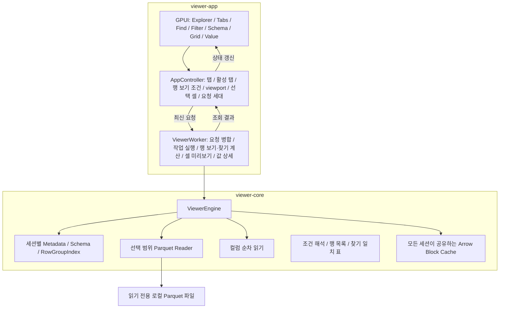

# Parquet Viewer 아키텍처와 구현 계획

## 1. 제품 범위와 기술 선택

Parquet Viewer는 로컬 Parquet 파일을 읽기 전용으로 열어 파일 구조와 데이터를 탐색하는 네이티브 데스크톱 앱이다. MVP는 **탐색기, 파일 열기, 탭, 스키마 조회, 행·열 가상화 그리드, 값 상세 보기**로 구성하고, 그 위에 **찾기, 필터, 정렬, 파일 구조 보기**를 더한다. 핵심 스택은 **Rust + GPUI + Arrow/Parquet**다.

이 앱은 원본 데이터가 어떻게 생겼는지와 파일이 어떻게 저장되어 있는지를 보는 도구다. 통계 분석과 집계는 다른 분석 도구에서 한다. 찾기·필터·정렬은 값을 계산하는 기능이 아니라 원본 행을 찾아가는 기능으로 둔다.

현재 개발 환경을 기준으로 1차 실행 대상을 Windows x64로 가정한다. 앱은 단일 창에서 여러 파일을 탭으로 열고 한 번에 한 탭을 활성화한다. 필터와 정렬이 없으면 데이터를 원본 파일의 행·열 순서로 표시한다.

| 영역 | 채택 기술과 역할 |
|---|---|
| 언어·빌드 | Rust, Cargo workspace |
| UI | GPUI 직접 사용. 창, 입력, 레이아웃, 텍스트와 그리드 렌더링 |
| Parquet 읽기 | arrow-rs의 `parquet`. Footer, 스키마, Row Group, 선택한 행·열 디코딩 |
| 데이터 표현 | `arrow-array`, `arrow-schema`. `RecordBatch`와 타입이 있는 컬럼 배열 |
| 비교·정렬 | `arrow-ord`. 찾기·필터의 값 비교와 정렬 순서 계산 |
| 로컬 파일 접근 | `std::fs`. 읽기 전용 파일 핸들과 디렉터리 조회 |
| 데이터 작업 실행 | 전용 `std::thread` worker 1개. 동기 Parquet 리더 실행 |
| 결과 전달 | `async-channel`의 bounded channel. worker 결과를 GPUI task에서 수신 |
| 캐시 | 엔진 내부의 byte budget 기반 LRU. 모든 탭이 한 예산을 공유 |

GPUI Kit은 의존성에 포함하지 않는다. 찾기·필터·정렬은 엔진의 컬럼 순차 읽기와 Arrow 비교·정렬 kernel로 구현하며, SQL·집계용 분석 엔진은 추가하지 않는다. 원본 파일의 수정·저장 API도 제공하지 않는다.

GPUI는 Zed 릴리스 revision 위에 `image` 코덱 축소 커밋 하나를 얹은 GitHub fork(`GreenWojaKK/zed`)의 정확한 커밋으로 고정한다. fork 커밋은 Zed 루트 `Cargo.toml`의 `image` 기능을 gpui가 직접 쓰거나 클립보드 변환에 쓰는 gif·jpeg·png·webp로 줄인다. GPUI를 올릴 때는 이 커밋을 새 릴리스 위에 다시 얹는다. 해당 revision의 Windows 예제를 기준으로 필요한 플랫폼 crate와 Rust toolchain을 함께 고정한다. `parquet`와 직접 사용하는 Arrow crate는 동일한 arrow-rs 릴리스 계열로 맞추고, 해석된 의존성을 `Cargo.lock`으로 고정한다.

## 2. 사용자 흐름과 화면

```text
┌─────────────────────────────────────────────────────────────────────┐
│ Open File    Open Folder                         활성 파일 이름       │
├────────────────┬──────────────────────────────────┬─────────────────┤
│ Explorer       │ [a.parquet ×][b.parquet ×] [데이터|파일 구조] │ Schema │
│                │ 찾기 막대 · 필터·정렬 막대         │ 필드·타입        │
│ 폴더 펼치기     │ Data Grid                        │ nullable        │
│ 파일 선택       │ 고정 컬럼 헤더 · 정렬·필터 표시     │ 중첩 필드 트리   │
│                │ 원본 행 번호 / 보이는 데이터 셀     ├─────────────────┤
│                │ 수직·수평 스크롤 · 셀 선택         │                 │
│                │                                  │ Value           │
│                │                                  │ 선택 셀 원본 값  │
│                │                                  │ 중첩 값 트리     │
├────────────────┴──────────────────────────────────┴─────────────────┤
│ 활성 탭의 파일 경로 · 전체 행 수 · 컬럼 수 · Row Group 수 · 읽기 상태  │
└─────────────────────────────────────────────────────────────────────┘
```

### 탐색기

- `Open Folder`로 루트 디렉터리를 선택한다. 폴더를 펼칠 때 직계 자식만 조회한다.
- 디렉터리와 확장자가 `.parquet`인 파일을 표시한다. 확장자는 대소문자를 구분하지 않는다.
- 디렉터리를 먼저, 같은 종류 안에서는 이름순으로 표시한다. 심볼릭 링크와 디렉터리 junction은 자동으로 따라가지 않는다.
- 펼쳐진 트리를 행 목록으로 변환하고, 화면에 보이는 항목만 렌더링한다.
- 파일 더블클릭 또는 선택 후 Enter는 `Open File`과 동일한 열기 요청을 발생시킨다.
- 폴더 조회 실패는 해당 노드에 오류와 재시도를 표시한다. 이미 열린 파일의 그리드는 유지한다.

### 파일 열기

- `Open File` 또는 `Ctrl+O`로 네이티브 파일 선택창을 연다. 선택창 취소는 현재 상태를 유지한다.
- 선택한 경로는 확장자와 관계없이 Parquet 리더로 검증한다. 확장자 필터는 탐색기의 표시 정책이다.
- 새 경로를 확정하면 새 탭을 만들어 활성화하고 `Opening` 상태로 시작한다. 이미 탭으로 열린 경로면 그 탭을 활성화한다.
- Footer와 메타데이터를 읽어 행 수·스키마를 먼저 표시한 뒤 첫 viewport의 데이터를 요청한다.
- 파일을 직접 열고 탐색기 루트가 없으면 부모 디렉터리를 탐색기 루트로 지정한다. 기존 루트가 있으면 유지한다.

GPUI의 `App::prompt_for_paths`를 파일·폴더 선택에 사용한다. [공식 API](https://docs.rs/gpui/latest/gpui/struct.App.html#method.prompt_for_paths)

### 탭

- 파일 하나를 탭 하나로 연다. 같은 경로를 두 탭에 열지 않는다.
- 탭 막대는 그리드 위에 파일 이름과 닫기 버튼을 표시한다. 탭 클릭으로 전환하고, `Ctrl+Tab`·`Ctrl+Shift+Tab`으로 다음·이전 탭, `Ctrl+W`로 활성 탭을 닫는다.
- 탭이 많으면 최소 폭까지 폭을 나눠 줄이고, 그래도 넘치면 탭 막대를 가로로 스크롤한다. 마우스 휠로 스크롤할 수 있고, 활성 탭이 바뀌면 그 탭이 보이도록 스크롤한다. 넘칠 때는 막대 아래에 스크롤 위치를 표시한다.
- 탭에 마우스를 올리면 파일의 전체 경로를 툴팁으로 표시한다. 줄어든 탭에서 이름이 잘려도 파일을 구별할 수 있다.
- 탭을 끌어 다른 탭 위에 놓으면 그 탭의 자리로 옮기고, 탭이 없는 빈 곳에 놓으면 마지막 자리로 옮긴다. 끄는 동안 놓을 자리의 탭을 강조한다. 순서를 바꿔도 활성 탭은 그대로다. 끄는 중에 탭 막대 양 끝 가까이 두면 막대가 그쪽으로 계속 스크롤되어, 보이지 않는 자리까지 옮길 수 있다.
- 그리드, 스키마, Value 패널, 상태 표시줄은 활성 탭의 내용을 표시한다.
- 탭마다 스크롤 위치, 선택 셀, 스키마 펼침 상태를 기억한다. 탭으로 돌아오면 그 상태로 셀 데이터를 다시 요청하고, 캐시에 남은 블록은 I/O 없이 표시한다.
- 활성 탭을 닫으면 오른쪽 탭을, 없으면 왼쪽 탭을 활성화한다. 탭을 모두 닫으면 빈 상태로 돌아간다.

### 스키마 조회

- Arrow 스키마의 필드 이름, 데이터 타입, nullable 속성을 표시한다.
- `Struct`, `List`, `Map`의 자식 타입은 펼칠 수 있는 트리로 표시한다. 펼쳐진 노드만 행 목록에 포함한다.
- 그리드의 컬럼 단위는 최상위 필드다. 중첩 필드를 펼쳐도 그리드 컬럼 수와 행 수는 바뀌지 않는다.
- 파일 요약에는 전체 행 수, 최상위 컬럼 수, Row Group 수, 파일 크기를 표시한다.
- 행이 0개인 파일도 스키마와 컬럼 헤더를 표시하고 본문에는 빈 데이터 상태를 표시한다.

### 데이터 그리드

- 고정 높이 행, 고정 너비 컬럼, 고정 헤더와 행 번호 영역을 사용한다.
- 수직·수평 스크롤바, 마우스 휠, Shift+휠의 수평 이동을 제공한다.
- 클릭으로 셀 하나를 선택하고 선택 셀을 강조 표시한다. 선택 셀은 값 상세 보기의 대상이다.
- 그리드에 포커스가 있을 때 방향키로 선택 셀을 행·열 단위로 이동하고, Page Up/Down으로 화면 단위 이동, Ctrl+Home/End로 첫 행·마지막 행으로 이동한다.
- 읽기 중인 셀은 placeholder로 표시한다. 데이터가 도착하면 해당 위치를 갱신한다.
- 셀은 값의 한 줄 미리보기다. 줄바꿈·탭·제어 문자는 표시 기호로 바꾸고 긴 값은 미리보기 길이에서 생략 표시를 붙인다. 원본 값 전체는 값 상세 보기에서 확인한다.

### 값 상세 보기

- Value 패널은 선택 셀의 값을 원본 그대로 표시한다. 선택 셀이 없으면 빈 상태를 표시한다.
- 패널 상단에 행 번호, 컬럼 이름, 타입, 값 크기를 표시한다. 값 크기는 문자열의 byte 길이와 문자 수, Binary의 byte 길이, List·Map의 원소·entry 개수다.
- 문자열은 줄바꿈을 유지한 원문 전체를, Binary는 전체 byte의 hex dump를 표시한다. 값의 길이와 관계없이 끝까지 스크롤할 수 있다.
- `Struct`, `List`, `Map` 값은 값 트리로 펼친다. 트리에서 노드를 선택하면 본문에 그 노드의 원본 값을 표시한다.
- `Ctrl+C`는 선택한 셀 또는 노드의 원본 값을 복사한다.
- 선택 셀이 그리드 화면 밖으로 스크롤되어도 Value 패널의 값은 유지한다.

### 행 보기

- 탭마다 필터 조건과 정렬 기준을 가진다. 이 둘이 그리드에 나오는 행과 그 순서를 정하며, 이를 행 보기라 한다. 필터와 정렬이 없으면 행 보기는 원본 파일의 행 순서다.
- 그리드의 행 위치, 스크롤, 선택 셀, 키 이동은 행 보기의 순서를 따른다. 행 번호 영역에는 원본 파일의 행 번호를 표시하고, Value 패널도 원본 행 번호를 표시한다.
- 필터나 정렬을 바꾸면 worker가 새 행 보기를 만든다. 만드는 동안 그리드는 이전 행 보기를 계속 표시하고, 그리드 위의 필터·정렬 막대에 진행률과 `취소`를 표시한다. 완성되면 그리드를 새 행 보기의 첫 행으로 옮기고 선택 셀을 해제한다. 가로 스크롤 위치는 유지한다. `취소`는 바꾸기 전의 조건으로 되돌린다.
- 필터·정렬 막대는 조건이 있을 때 표시한다. 조건마다 `×`로 해제하는 항목을 두고, `모두 해제`로 원본 순서로 돌아간다. 상태 표시줄은 행 보기의 행 수와 전체 행 수를 함께 표시한다.
- 행 보기는 탭마다 기억한다. 탭을 전환해도 조건과 결과가 유지된다.

### 찾기

- `Ctrl+F`로 그리드 위에 찾기 막대를 열고 입력란에 포커스를 옮긴다. `Esc`는 찾기 막대를 닫고 그리드로 포커스를 돌린다.
- 찾기는 값 전체가 입력과 정확히 같은 셀을 찾는다. 대소문자를 구분하고, 일부만 일치하는 값은 찾지 않는다.
- 비교 대상은 셀에 표시되는 값의 전체 텍스트다. 문자열은 원문, 수치·시간·Boolean은 셀 표시 계약의 텍스트, Binary는 복사 텍스트와 같은 소문자 16진수다. 입력의 16진수는 대소문자를 구분하지 않는다. Null과 `Struct`·`List`·`Map` 셀은 찾기 대상이 아니다.
- `Enter`·`F3`은 다음 일치, `Shift+Enter`·`Shift+F3`은 이전 일치로 이동한다. 순서는 행 보기의 행 순서, 같은 행 안에서는 컬럼 순서다. 선택 셀에서 출발하고, 끝에 닿으면 처음으로 돌아간다.
- 찾은 셀을 선택하고 화면에 보이게 스크롤한다. 찾기 막대에는 행 보기 전체의 일치 셀 수를 표시한다. 그리드에서는 일치하는 셀을 강조한다.
- 입력을 바꾼 뒤 처음 `Enter`를 누를 때 파일을 읽어 일치 위치를 계산한다. 계산하는 동안 찾기 막대에 진행률을 표시하고, 그리드 스크롤·셀 선택·탭 전환은 계속 동작한다.
- 필터·정렬을 적용하는 중에는 찾기를 시작하지 않고 찾기 막대에 안내를 표시한다. 탭을 전환하면 찾기 결과는 새 탭 기준으로 다시 계산한다.

### 필터

- 컬럼 헤더 오른쪽의 필터 버튼을 누르면 그 컬럼의 필터 창을 연다. 필터 창은 연산자 버튼, 값 입력란, `적용`, `필터 해제`로 구성한다. `Enter`는 적용, `Esc`와 창 밖 클릭은 닫기다.
- 컬럼마다 조건 하나를 둔다. 여러 컬럼의 조건은 모두 만족하는 행만 남긴다. 새 조건의 연산자는 문자열 컬럼이면 `포함`, 그 밖에는 목록의 첫 연산자다.
- 연산자는 컬럼 타입에 따라 다음과 같다.

| 컬럼 타입 | 연산자 |
|---|---|
| 문자열 | `=`, `≠`, `포함`, `<`, `≤`, `>`, `≥`, `null`, `null 아님` |
| Boolean·정수·실수·Decimal·Date·Time·Timestamp | `=`, `≠`, `<`, `≤`, `>`, `≥`, `null`, `null 아님` |
| Binary | `=`, `≠`, `null`, `null 아님` |
| `Struct`·`List`·`Map`과 그 밖의 타입 | `null`, `null 아님` |

- 비교 연산자의 값은 컬럼 타입으로 해석해 값끼리 비교한다. 예를 들어 Decimal 컬럼의 `= 1.5`는 `1.50`과 일치하고, Timestamp는 ISO 8601 형식으로 입력한다. 해석할 수 없는 값은 적용하지 않고 필터 창에 오류를 표시한다.
- 문자열 비교와 `포함`은 대소문자를 구분한다. 문자열의 `<`·`>`는 UTF-8 byte 순서다. Binary 값은 16진수로 입력한다.
- 비교 연산자와 `포함`은 Null 셀과 일치하지 않는다. Null 셀은 `null` 연산자로 고른다.
- 필터가 있는 컬럼은 헤더의 필터 버튼을 강조한다.

### 정렬

- 컬럼 헤더를 누를 때마다 오름차순, 내림차순, 정렬 해제 순으로 바뀐다. 정렬 기준은 컬럼 하나이며, 다른 컬럼 헤더를 누르면 그 컬럼의 오름차순으로 바꾼다. 헤더에 `▲`·`▼`로 방향을 표시한다.
- 필터가 있으면 필터를 통과한 행만 정렬한다.
- Null은 방향과 관계없이 마지막에 둔다. 값이 같은 행은 원본 파일의 순서를 유지한다.
- 문자열은 UTF-8 byte 순서, 실수의 NaN은 가장 큰 값으로 정렬한다.
- `Struct`·`List`·`Map`과 표시 미지원 타입의 컬럼은 정렬하지 않는다. 이런 헤더를 누르면 필터·정렬 막대에 정렬할 수 없다는 안내를 표시한다.

### 파일 구조

- 탭 막대 오른쪽의 `데이터`·`파일 구조`로 탭 본문을 바꾼다. 탭마다 마지막으로 고른 쪽을 기억한다. 파일 구조에서 `Ctrl+F`를 누르면 데이터로 돌아가 찾기를 연다.
- 파일 구조는 Parquet 메타데이터에 적힌 정보만 보여준다. 데이터 페이지는 읽지 않으므로 파일 크기와 관계없이 바로 표시한다.
- 위쪽에 파일 요약을 표시한다. Parquet 형식 버전, 파일을 쓴 프로그램, 압축 전후 데이터 크기와 압축률, key-value 메타데이터의 key와 값 크기다.
- 가운데 표는 leaf 컬럼마다 경로, 물리 타입과 논리 타입, 압축 방식, 압축 후·전 크기, 압축률, null 수, 최솟값, 최댓값, 페이지 인덱스·Bloom filter 유무를 표시한다. 칸에 마우스를 올리면 잘린 내용 전체와 인코딩 목록을 툴팁으로 표시한다.
- 아래 표는 Row Group마다 행 수, 압축 후·전 크기, 압축률을 표시한다. 첫 행 `전체`는 모든 Row Group의 합계다. Row Group을 고르면 가운데 표가 그 Row Group의 정보로 바뀐다.
- 최솟값·최댓값은 Row Group별 통계를 Arrow 타입으로 바꿔 비교하고 셀 표시 계약과 같은 형식으로 표시한다. 파일에 잘라 적힌 근삿값은 `≈`를 붙인다. 통계가 없거나 중첩 컬럼의 leaf이면 `-`로 표시한다. null 수는 모든 Row Group에 적혀 있을 때만 합계를 표시한다.

## 3. 구성 요소와 의존성

Cargo workspace는 `viewer-app`과 `viewer-core` 두 crate로 구성한다.



| 구성 요소 | 책임과 소유 상태 |
|---|---|
| `AppController` | 탭 목록과 활성 탭, `SessionId`·`RequestId` 발급, 활성 탭의 viewport·값·찾기 요청별 최신 `RequestId`, 오류 표시 |
| 탭 상태 | 탭마다 경로, `SessionId`, 파일 상태, 그리드 스크롤 위치, 선택 셀, 스키마 펼침 상태, 적용한 행 보기 조건과 그 `ViewId`·행 수, 만드는 중인 조건 |
| `TabBar` | 탭 이름, 활성 표시, 전환·닫기·순서 이동 입력 |
| `FindBar` | 찾기 입력, 일치 셀 수와 진행률, 이전·다음 입력 |
| `FilterPopover` | 필터를 거는 컬럼, 연산자, 값 입력, 해석 오류 |
| `ViewBar` | 행 보기의 필터·정렬 조건 목록, 진행률과 취소, 정렬할 수 없는 컬럼 안내 |
| `StructureView` | 활성 탭의 파일 구조, 고른 Row Group과 그 컬럼 정보 |
| `TextInput` | 한 줄 텍스트 입력. 커서·선택·클립보드·IME 조합 입력 |
| `ExplorerView` | 루트 경로, 펼쳐진 폴더, 선택한 파일, 디렉터리 조회 상태 |
| `SchemaView` | 활성 탭의 스키마 노드와 펼침 상태 |
| `GridView` | 활성 탭의 논리 스크롤 위치, 보이는 행·열 범위, 셀 미리보기와 원본 행 번호, 헤더의 정렬·필터 표시, 입력·렌더링 |
| `ValueView` | 값 트리 노드와 펼침 상태, 선택 노드, 본문 값과 표시 줄 인덱스, 본문 스크롤 위치 |
| `ViewerWorker` | 열기·닫기 명령 처리, 최신 요청 선택, 엔진 호출, 결과 세대 검사, Arrow 값의 제한된 텍스트 변환, 선택 값 보유와 상세 표시·복사 텍스트 생성, 세션별 행 목록 보유와 행 보기 위치의 원본 행 변환, 행 보기·찾기 계산 작업 |
| `ViewerEngine` | 열린 세션별 파일 핸들·메타데이터·Row Group 인덱스, 읽기 계획, 디코딩, 컬럼 순차 읽기, 임의 행 읽기, 모든 세션이 공유하는 캐시 |

`viewer-core`의 공개 타입은 Rust 표준 타입과 Arrow 타입으로 구성한다. GPUI의 `Entity`, `Context`, `Window`는 `viewer-app` 안에서만 사용한다. 앱은 엔진의 공개 API로 데이터를 요청하며, GPUI의 layout·paint 콜백은 이미 준비된 화면 상태만 읽는다.

데이터 엔진의 실행 주체는 `ViewerWorker`다. 탐색기의 디렉터리 조회는 별도의 GPUI background task로 실행하며, 동일 폴더의 진행 중 요청은 합친다. 탐색기 루트가 바뀌면 이전 루트의 응답을 폐기한다.

### 구현 시 생성할 디렉터리

```text
TPUI/
├── architecture.md
├── Cargo.toml
├── Cargo.lock
├── rust-toolchain.toml
└── crates/
    ├── viewer-app/
    │   ├── Cargo.toml
    │   └── src/
    │       ├── main.rs
    │       ├── app.rs
    │       ├── worker.rs
    │       ├── cell_preview.rs
    │       ├── value_detail.rs
    │       ├── format.rs
    │       └── ui/
    │           ├── explorer.rs
    │           ├── tab_bar.rs
    │           ├── schema.rs
    │           ├── grid.rs
    │           ├── value.rs
    │           ├── text_input.rs
    │           ├── find_bar.rs
    │           ├── filter_popover.rs
    │           ├── view_bar.rs
    │           ├── structure.rs
    │           └── theme.rs
    └── viewer-core/
        ├── Cargo.toml
        ├── src/
        │   ├── lib.rs
        │   ├── model.rs
        │   ├── engine.rs
        │   ├── reader.rs
        │   ├── row_index.rs
        │   ├── cache.rs
        │   ├── scan.rs
        │   ├── condition.rs
        │   ├── row_view.rs
        │   ├── find.rs
        │   ├── structure.rs
        │   └── error.rs
        └── tests/
            └── reader_contract.rs
```

## 4. 엔진 API와 데이터 계약

공개 API는 동일 프로세스에서 호출하는 동기 Rust API다. worker가 호출 시점을 관리한다.

| API | 입력 | 결과와 동작 |
|---|---|---|
| `open` | `SessionId`, `Path` | 읽기 전용 핸들과 메타데이터를 열어 세션으로 추가하고 `DatasetInfo` 반환. 다른 세션은 유지 |
| `plan_window` | `WindowRequest` | 파일 범위와 교차한 행·열을 Row Group별 `BlockRequest`로 분할 |
| `read_block` | `BlockRequest`, 취소 상태 | 캐시를 조회하거나 선택 범위를 디코딩해 `DecodedBlock` 반환 |
| `read_value` | `ValueRequest`, 취소 상태 | 대상 셀이 속한 블록을 캐시에서 찾거나 디코딩해 그 셀만 담은 `ValueSlice` 반환 |
| `read_rows` | `SessionId`, 원본 행 목록, 컬럼 목록, 취소 상태 | 행마다 속한 블록을 캐시에서 찾거나 디코딩하고, 행 목록의 순서대로 모은 `RecordBatch` 반환 |
| `file_structure` | `SessionId` | 메타데이터만으로 만든 `FileStructure` 반환. 파일 요약, Row Group별 크기, 모든 Row Group을 합친 leaf 컬럼별 저장 정보 |
| `row_group_columns` | `SessionId`, Row Group 위치 | 그 Row Group의 leaf 컬럼별 저장 정보 반환 |
| `scan` | `SessionId`, 컬럼 목록, 오름차순 원본 행 목록(선택) | 컬럼 순차 읽기 `ColumnScan` 반환. 호출할 때마다 다음 배치를 원본 순서로 돌려준다. 행 목록이 있으면 그 행만 읽는다. 캐시는 쓰지 않는다 |
| `close` | `SessionId` | 해당 세션의 파일 핸들, 메타데이터, 인덱스, 캐시 항목 해제 |

`DatasetInfo`에는 `SessionId`, 경로, 파일 크기, 전체 행 수, `SchemaRef`, Row Group별 행 수를 담는다. `DecodedBlock`에는 `SessionId`, 파일 기준 시작 행, 실제 행 수, 원본 컬럼 ID 목록, `RecordBatch`를 담는다. `ValueSlice`에는 `SessionId`, 전역 행, `ColumnId`, 원본 `Field`, 대상 셀 하나를 담은 길이 1의 Arrow 배열을 담는다.

핵심 요청 타입은 다음 계약을 사용한다.

```rust
pub struct SessionId(pub u64);
pub struct RequestId(pub u64);
pub struct ColumnId(pub usize); // 원본 스키마의 최상위 필드 위치

pub struct WindowRequest {
    pub session: SessionId,
    pub request: RequestId,
    pub rows: std::ops::Range<u64>,
    pub columns: Vec<ColumnId>,
}

pub struct ValueRequest {
    pub session: SessionId,
    pub request: RequestId,
    pub row: u64,
    pub column: ColumnId,
}

pub enum FilterOp { Eq, NotEq, Contains, Lt, LtEq, Gt, GtEq, IsNull, IsNotNull }

pub struct FilterCondition {
    pub column: ColumnId,
    pub op: FilterOp,
    pub value: String, // 사용자가 입력한 값. 컬럼 타입으로 해석한다
}

pub struct SortKey {
    pub column: ColumnId,
    pub descending: bool,
}

pub struct ViewSpec {
    pub filters: Vec<FilterCondition>, // 컬럼마다 하나
    pub sort: Option<SortKey>,
}
```

- 엔진의 행 번호는 0부터 시작하고 범위는 `[start, end)`다. 화면 행 번호만 1부터 표시한다.
- 전체 행 수와 행 위치는 `u64`로 유지한다. 배치 내부 접근 시 검증된 범위만 `usize`로 변환한다.
- 요청 컬럼은 원본 스키마 순서로 정렬·중복 제거한다. 범위를 벗어난 컬럼 ID는 오류로 반환한다.
- 행 범위는 `[0, total_rows)`와 교차한다. 빈 교집합은 빈 결과이며 I/O를 실행하지 않는다. `start > end`는 요청 오류다.
- `ValueRequest`의 행이 `[0, total_rows)` 밖이면 요청 오류다.
- 응답의 컬럼 ID로 원본 필드와 projected batch의 위치를 연결한다. 컬럼 이름은 식별자로 사용하지 않는다.
- 열려 있지 않은 세션의 요청은 `StaleSession`으로 종료한다.

## 5. 파일 열기와 선택 범위 읽기

### 메타데이터 우선 열기

1. `std::fs::File::open`으로 파일을 연다.
2. Footer와 Parquet 메타데이터를 읽고 Arrow 스키마를 구성한다.
3. Row Group별 행 수로 누적 offset을 만든다.
4. `DatasetInfo`를 UI에 전달해 스키마와 파일 요약을 표시한다.
5. 첫 viewport 요청에 대해 필요한 데이터 블록을 디코딩한다.

메타데이터는 파일 세션 동안 재사용한다. `ParquetRecordBatchReaderBuilder::new_with_metadata`는 이미 읽은 메타데이터로 reader를 구성한다. [공식 API](https://docs.rs/parquet/latest/parquet/arrow/arrow_reader/type.ParquetRecordBatchReaderBuilder.html#method.new_with_metadata)

### Row Group 인덱스

Row Group이 `G`개이고 각 행 수가 `n[i]`이면 길이 `G + 1`의 누적 배열을 만든다.

```text
offsets[0] = 0
offsets[i + 1] = offsets[i] + n[i]
전체 행 수 = offsets[G]
```

전역 행 `r`은 `offsets[i] <= r < offsets[i + 1]`을 만족하는 Row Group에 속한다. upper-bound 이진 탐색으로 찾고, 그룹 내부 행은 `r - offsets[i]`로 계산한다. 행 수가 0인 Row Group도 동일 규칙으로 건너뛴다. 누적합은 checked arithmetic으로 계산한다.

인덱스 생성은 `O(G)`, 단일 행의 그룹 조회는 `O(log G)`다. MVP에서는 메타데이터 크기의 누적합을 CPU에서 계산한다.

### 디코딩 단위

읽기 단위는 **한 Row Group 안의 최대 512행 × 요청한 최상위 컬럼 집합**이다. 블록 시작은 Row Group 내부의 512행 경계에 정렬한다. 마지막 블록은 그룹 끝에서 잘린다.

1. 요청 행 범위를 Row Group별 구간으로 나눈다.
2. 각 구간과 겹치는 블록을 선택하고, 현재 viewport와 겹치는 블록부터 처리한다.
3. `with_row_groups`로 Row Group 하나를 선택한다.
4. `ProjectionMask::roots`로 최상위 컬럼 집합을 지정한다.
5. `RowSelection`의 skip/select로 그룹 내부 블록을 지정하고 `with_batch_size(512)`로 읽는다.
6. worker가 실제 필요한 셀의 미리보기를 생성해 UI에 전달한다.

`with_row_groups`는 `RowSelection`보다 먼저 적용되므로, selection의 행 위치는 선택된 Row Group 기준으로 만든다. [Reader API](https://docs.rs/parquet/latest/parquet/arrow/arrow_reader/struct.ArrowReaderBuilder.html#method.with_row_selection)

최상위 필드 projection은 중첩 필드의 leaf projection과 구분한다. `ProjectionMask::roots`는 요청한 최상위 필드의 하위 컬럼을 포함한다. [ProjectionMask API](https://docs.rs/parquet/latest/parquet/arrow/struct.ProjectionMask.html#method.roots)

Parquet page의 압축 해제·디코딩 중에는 요청한 행보다 많은 데이터를 처리할 수 있다. 따라서 블록을 순차 실행하고 각 배치 처리 전후에 취소 상태를 검사한다. Page Index가 없는 파일도 같은 읽기 계약으로 처리한다.

### 단일 값 조회

`read_value`는 블록 읽기와 같은 규칙으로 대상 행이 속한 블록을 정한다.

1. 캐시에서 같은 Row Group과 블록 시작을 가지며 대상 컬럼을 포함한 항목을 찾는다.
2. 없으면 대상 컬럼 하나만 projection한 블록을 읽고 캐시에 넣는다.
3. 블록 배치에서 대상 셀만 담은 길이 1의 새 배열로 복사해 `ValueSlice`로 반환한다. 반환 값은 블록 전체의 buffer를 유지하지 않는다.

Parquet는 값 하나를 부분적으로 디코딩하지 않으므로, 선택 값은 디코딩 후 전체가 메모리에 올라온다. 큰 값의 화면 처리 비용은 값 상세 보기의 표시 줄 가상화로 제한한다.

## 6. 가상화 그리드

### viewport 계산과 렌더링

`GridView`는 `first_visible_row: u64`와 행 내부 pixel offset을 저장한다. 전체 행 수에 행 높이를 곱한 거대한 GPUI element를 생성하지 않고, 화면 내부의 상대 좌표로 셀을 배치한다. 수직 스크롤바의 위치 비율은 `f64`로 계산하고, 행 단위 키 입력은 정수 행 위치를 갱신한다.

가로 위치도 첫 컬럼 ID와 컬럼 내부 offset으로 저장한다. 고정 컬럼 너비로 보이는 컬럼 범위를 계산한다. 헤더와 본문은 동일한 가로 위치를 사용하고 행 번호 영역은 수평 이동에서 고정한다.

- viewport의 위·아래 각 8행, 좌·우 각 1컬럼을 overscan으로 요청한다.
- 그리드의 생성·포맷팅 대상 수는 viewport와 overscan의 행 수 × 컬럼 수에 비례한다.
- 스크롤과 창 크기 변경으로 요청 범위가 바뀌면 최신 `WindowRequest`를 등록한다. 범위가 같으면 재요청하지 않는다.
- 현재 화면과 겹치는 기존 셀은 유지하고, 새로 노출된 셀만 placeholder로 표시한다.
- 그리드는 GPUI custom `Element`로 layout·hitbox·paint를 구현한다. 탐색기와 스키마의 일정 높이 행 목록에는 `uniform_list`를 사용한다. [Element API](https://docs.rs/gpui/latest/gpui/trait.Element.html), [uniform_list API](https://docs.rs/gpui/latest/gpui/fn.uniform_list.html)

### 셀 표시 계약

셀 미리보기는 그리드에 그리기 위한 요약이며 worker에서 생성한다. GPUI 렌더링은 미리보기의 텍스트와 스타일만 사용한다. 미리보기에서 생략하거나 요약한 내용은 값 상세 보기에서 전체를 표시한다.

| 데이터 | 표시 |
|---|---|
| Null | `null` 전용 스타일. 빈 문자열과 구분 |
| Boolean·정수·실수·Decimal | 타입에 맞는 값. Decimal scale 유지 |
| Date·Time·Timestamp | 값과 정밀도를 유지. Timestamp timezone이 있으면 함께 표시 |
| 문자열 | 최대 256 Unicode scalar value의 미리보기와 생략 표시 |
| Binary | 앞 32바이트의 16진수 미리보기와 전체 byte 길이 |
| Struct | `Struct {필드 수}` 요약 |
| List·Map | 원소·entry 개수 요약 |
| Dictionary | 참조된 값의 타입에 따른 표시 |
| 표시 미지원 타입 | 타입 이름과 `표시 미지원` 상태 |

문자열은 필요한 접두부만 복사하고, 중첩 값은 요약을 생성한다. Timestamp의 timezone 정보가 없으면 임의의 로컬 timezone으로 변환하지 않는다. 디코딩 오류는 표시 미지원 셀과 구분해 데이터 읽기 오류로 처리한다.

## 7. 값 상세 보기

그리드 셀은 화면에 그리기 위한 미리보기다. 원본 값의 확인과 복사는 값 상세 보기가 담당하며, 값의 길이와 형태에 관계없이 전체를 보여준다.

### 데이터 흐름

1. 선택 셀이 바뀌면 `AppController`가 새 `RequestId`로 `ValueRequest`를 등록한다.
2. worker는 현재 viewport의 블록을 처리한 뒤 값 요청을 처리한다. viewport 안의 선택 셀은 캐시에서 찾는다.
3. worker는 `read_value`가 반환한 `ValueSlice`를 선택 값으로 보관하고, 루트 노드의 상세 표시 모델을 UI에 보낸다.
4. 중첩 노드를 펼치면 UI가 루트부터의 자식 위치 목록으로 노드를 지정해 자식 목록을 요청한다. worker는 선택 값에서 자식 노드를 만든다.
5. 노드를 선택하면 worker가 그 노드의 원본 값 전체를 UI로 보낸다. 문자열은 텍스트 복사본, Binary는 byte 복사본, 그 밖의 스칼라는 표시 텍스트다.

탭을 전환하면 이전 탭의 선택 값을 해제한다. 새 활성 탭에 선택 셀이 있으면 그 값을 다시 요청한다.

### 값 트리와 본문

| 데이터 | 값 트리의 노드 | 본문 |
|---|---|---|
| Null | `null` 전용 스타일 | `null` 전용 스타일. 빈 문자열과 구분 |
| Boolean·정수·실수·Decimal·Date·Time·Timestamp | 셀 표시 계약과 같은 텍스트 | 셀 표시 계약과 같은 텍스트 |
| 문자열 | 한 줄 미리보기와 문자 수 | 원문 전체 |
| Binary | 앞부분의 16진수 미리보기와 byte 길이 | 전체 byte의 hex dump. 줄마다 offset, 16 byte의 16진수, ASCII 표시 |
| Struct | 필드 이름별 자식 노드 | 필드 수 요약 |
| List | 원소 위치별 자식 노드 | 원소 개수 요약 |
| Map | entry별 자식 노드. entry 아래에 key·value 노드 | entry 개수 요약 |
| Dictionary | 참조된 값의 타입에 따른 노드 | 참조된 값의 타입에 따른 본문 |
| 표시 미지원 타입 | 타입 이름과 `표시 미지원` 상태 | `arrow-cast`의 표시 formatter가 만든 텍스트. formatter도 지원하지 않으면 타입 이름과 `표시 미지원` 상태 |

- 스칼라 셀은 값 트리 없이 본문만 표시한다.
- 자식이 1,000개를 넘는 노드는 자식을 1,000개 단위의 구간 노드로 묶는다. 구간 노드를 펼칠 때 그 구간의 자식만 만든다.

### 본문 표시

- 본문은 고정폭 글꼴을 사용한다. 문자열의 줄바꿈(`\n`, `\r\n`, `\r`)은 줄을 나누고, 탭과 그 밖의 제어 문자는 표시 기호로 보여준다. 패널 폭을 넘는 줄은 패널 폭에서 자동 줄바꿈한다.
- 표시 기호와 자동 줄바꿈은 화면 표시에만 적용한다. 원본 값과 복사 결과는 바꾸지 않는다.
- UI는 본문의 표시 줄 시작 위치 인덱스를 GPUI background task로 만들고, 패널 폭이 바뀌면 다시 만든다. 인덱스를 만드는 동안 본문에 `Loading`을 표시한다.
- 본문은 표시 줄 단위의 `uniform_list`로 보이는 줄만 렌더링한다. hex dump는 16 byte마다 한 줄이므로 인덱스 없이 줄 번호로 위치를 계산한다.

### 복사

그리드에 포커스가 있으면 선택 셀의 값을, Value 패널에 포커스가 있으면 선택 노드의 값을 복사한다. worker가 선택 값에서 복사 텍스트를 만들고 UI가 클립보드에 쓴다. 미리보기 텍스트는 복사에 사용하지 않는다.

| 데이터 | 복사 텍스트 |
|---|---|
| 문자열 | 원문 그대로 |
| Binary | 공백 없는 소문자 16진수 |
| Null | `null` |
| 그 밖의 스칼라 | 본문 텍스트 |
| Struct·List·Map | JSON. Struct는 객체, List는 배열, Map은 `{"key": …, "value": …}` 객체의 배열. 내부의 Binary는 16진수 문자열, NaN·Infinity와 시간 값은 문자열 |

큰 값의 복사는 값 크기만큼의 텍스트를 만든다. 텍스트 생성은 worker에서 실행하며 UI thread를 막지 않는다.

## 8. 행 보기와 찾기

### 컬럼 순차 읽기

`ColumnScan`은 Row Group 순서로 요청한 최상위 컬럼만 읽고, 한 번에 최대 8,192행 배치를 돌려준다. 오름차순 원본 행 목록이 있으면 Row Group마다 그 행만 담은 `RowSelection`으로 읽고, 목록의 행이 없는 Row Group은 열지 않는다. 배치마다 그 배치가 행 목록 또는 파일의 몇 번째 행부터인지 함께 돌려준다.

순차 읽기는 캐시를 쓰지 않고, 돌려준 배치를 보유하지 않는다. Row Group을 시작할 때마다 파일 크기와 수정 시각을 확인한다.

### 행 목록

행 보기는 원본 행 번호의 배열인 행 목록으로 표현한다. 전체 행 수가 `u32` 범위 안이면 행마다 4 byte, 그보다 크면 8 byte를 쓴다. 필터와 정렬이 없으면 행 목록을 만들지 않는다.

- 필터 행 목록: 필터를 통과한 원본 행을 오름차순으로 담는다. 필터가 있을 때만 만든다.
- 표시 순서 목록: 정렬한 순서의 원본 행을 담는다. 정렬이 있을 때만 만들고, 정렬만 있으면 전체 행을, 필터도 있으면 필터 행 목록의 행을 담는다.

행 보기의 i번째 행은 표시 순서 목록이 있으면 그 i번째, 없으면 필터 행 목록의 i번째, 둘 다 없으면 원본 i번째 행이다.

### 필터 계산

1. 조건마다 값을 컬럼 타입으로 해석한다. 문자열 컬럼은 입력 그대로, Binary는 16진수로, 그 밖의 타입은 `arrow-cast`의 문자열 변환으로 해석한다. Dictionary 컬럼은 참조하는 값의 타입으로 해석한다.
2. 조건이 있는 컬럼만 순차 읽기로 읽는다.
3. 배치마다 조건별 Boolean 결과를 만들고, Null 결과를 거짓으로 바꾼 뒤 모두 AND한다. 비교는 `arrow-ord`의 비교 kernel을, `포함`은 문자열 검색을 쓴다.
4. 참인 행의 원본 번호를 필터 행 목록에 추가한다.

### 정렬 계산

1. 필터 행 목록이 있으면 그 행만, 없으면 전체 행의 정렬 컬럼을 순차 읽기로 읽는다. Dictionary는 참조하는 값의 배열로 바꿔 모은다.
2. 모은 값을 배열 하나로 합치고, `(정렬 값, 행 보기 안의 위치)`를 키로 `lexsort_to_indices`를 실행한다. 정렬 값은 지정한 방향에 Null을 마지막으로 두고, 위치는 오름차순이다. 따라서 값이 같은 행은 원본 순서를 유지한다.
3. 결과 위치를 원본 행 번호로 바꿔 표시 순서 목록을 만든다. 정렬 값 배열은 계산이 끝나면 해제한다.

정렬하는 행 수는 `u32` 범위 안이어야 한다. 넘으면 정렬하지 않고 안내를 표시한다.

### 행 보기의 화면 읽기

원본 순서의 행 보기는 블록 읽기로 화면 범위를 읽는다. 행 목록이 있으면 worker가 화면 범위의 원본 행 번호를 꺼내 `read_rows`로 읽고, 셀 미리보기와 함께 원본 행 번호를 UI에 보낸다. `read_rows`도 블록 캐시를 쓴다. 정렬한 행 보기는 화면의 행이 여러 블록에 흩어지므로, 화면 하나에 읽는 블록 수가 최대 화면의 행 수까지 늘어난다.

값 요청은 행 보기 위치로 보내고 worker가 원본 행으로 바꿔 `read_value`를 호출한다.

### 찾기 계산

1. 입력을 컬럼별 비교 값으로 해석한다. 문자열 컬럼은 입력 그대로, Binary 컬럼은 16진수로 해석한다. 그 밖의 스칼라 컬럼은 입력을 컬럼 타입으로 해석한 뒤 셀 표시 텍스트로 다시 바꾸고, 그 텍스트가 입력과 같을 때만 비교 대상으로 삼는다. 표시 텍스트는 값마다 하나로 정해지므로 값 비교가 표시 텍스트 비교와 같다. 비교 대상이 없는 컬럼은 읽지 않는다.
2. 행 보기의 행(필터 행 목록이 있으면 그 행)만 비교 대상 컬럼을 순차 읽기로 읽는다. 일치하는 셀이 있는 원본 행을 bitmap에 표시하고 일치 셀 수를 센다. bitmap은 원본 행마다 1 bit다.
3. 다음·이전 일치는 시작 셀의 같은 행에서 다음 컬럼을 먼저 보고, 행 보기 순서로 bitmap을 검사해 일치 행을 찾는다. 찾은 행은 `read_rows`로 비교 대상 컬럼을 읽어 일치하는 첫 컬럼(이전 일치는 마지막 컬럼)을 정한다.

찾기 결과는 세션, 행 보기, 입력이 모두 같을 때 다시 쓴다. worker는 가장 최근의 결과 하나만 보관한다. 그리드의 일치 셀 강조는 화면 범위 요청에 찾기 입력을 함께 보내, worker가 미리보기를 만들 때 같은 비교로 표시한다.

### 계산 작업의 실행

행 보기와 찾기의 계산은 데이터 worker thread에서 배치 단위로 나눠 실행한다. 배치 하나를 처리할 때마다 mailbox를 확인해 열기·닫기·화면 범위·값 요청을 먼저 처리한다. 따라서 계산 중에도 스크롤, 셀 선택, 탭 전환이 동작하고, 동시에 디코딩하는 작업은 1개로 유지된다.

- 세션마다 행 보기 요청은 최신 하나만 둔다. 같은 세션의 새 요청, 취소, 탭 닫기는 진행 중인 계산을 버린다. 다른 세션의 계산은 순서대로 실행한다.
- 찾기 요청은 활성 탭의 최신 하나만 둔다. 같은 세션의 행 보기 계산이 남아 있으면 그 뒤에 실행한다.
- 진행률은 최대 100ms마다 한 번 UI로 보낸다.

## 9. 요청 수명과 캐시

### 파일 세대와 viewport 세대

- 탭으로 파일을 열 때마다 새 `SessionId`를 발급한다.
- viewport 요청과 값 요청은 활성 탭에서만 발생한다. viewport 요청이 바뀔 때마다 `RequestId`를 증가시킨다.
- 값 요청도 같은 발급기에서 `RequestId`를 받는다. controller는 viewport와 값의 최신 `RequestId`를 따로 보관하고, 결과는 같은 종류의 최신 요청과 일치할 때만 반영한다.
- 대기 중인 viewport 요청과 값 요청은 각각 최신 요청 하나로 교체한다. 탭을 전환하면 이전 탭의 대기 요청이 새 활성 탭의 요청으로 교체된다. 선택이 바뀌면 이전 값의 노드 펼치기·복사 요청과 결과를 폐기한다.
- 열기·닫기 명령은 요청 순서대로 모두 처리한다. 아직 처리하지 않은 열기 명령의 탭을 닫으면 그 열기 명령을 취소한다. 닫힌 탭의 세션 응답은 폐기한다.
- worker는 블록 읽기 전, 배치 디코딩 후, 결과 송신 전에 세대를 확인한다.
- 취소된 요청의 결과는 UI로 전달하지 않는다. 이미 진행 중인 동기 I/O는 반환된 뒤 세대를 검사한다.
- 같은 세션에서 완료된 블록은 캐시에 재사용할 수 있다. UI는 현재 `SessionId`와 `RequestId`에 일치하는 결과만 반영한다.
- 행 보기 요청도 같은 발급기에서 `RequestId`를 받고, 완성된 행 보기는 그 번호로 구분한다. 탭은 그리드에 표시 중인 행 보기의 번호를 가진다. viewport·값·찾기 요청은 이 번호를 함께 보내고, worker는 세션의 현재 행 보기와 번호가 다른 요청을 버린다. UI는 새 행 보기의 완성 결과를 받은 뒤에 그 번호로 요청한다.
- 행 보기 계산은 세션 단위로 실행하므로 탭을 전환해도 멈추지 않는다. 결과는 그 탭의 최신 행 보기 요청과 번호가 같을 때만 반영한다.

요청 mailbox는 열기·닫기 명령의 순서 목록, 최신 viewport, 최신 값 요청과 그 값의 노드 펼치기·복사 요청, 세션별 최신 행 보기 요청, 최신 찾기 요청, 최신 파일 구조 요청을 보관하고, worker를 깨우는 신호는 용량 1로 합친다. worker는 닫기, 열기, viewport, 값 요청, 노드 펼치기·복사, 파일 구조, 찾기 이동 순서로 처리하고, 처리할 요청이 없을 때 행 보기·찾기 계산을 배치 하나만큼 진행한다. mailbox 잠금 구간에서는 I/O를 실행하지 않는다. 결과 channel 용량은 2로 제한하며, UI의 GPUI task가 비동기로 수신한다. UI thread에서 worker 완료를 기다리지 않는다.

### 캐시와 메모리 수명

캐시 키는 `(SessionId, RowGroupId, block_start, 정렬된 ColumnId 목록)`이다. 캐시 값은 해당 projection의 Arrow `RecordBatch`와 전역 행 위치다.

캐시는 엔진 하나에 하나만 두고 모든 탭이 같은 예산을 공유한다. LRU는 탭과 관계없이 최근 사용 순서로 제거하므로, 오래 보지 않은 탭의 블록이 먼저 밀려난다. 탭을 닫으면 그 세션의 캐시 항목을 즉시 제거한다.

| 항목 | 초기 구현값 |
|---|---|
| 데이터 worker 동시 디코딩 | 1개 |
| 행 블록·출력 배치 크기 | 최대 512행 |
| 유지하는 Arrow 캐시 예산 | 모든 탭 합계 128 MiB |
| 결과 channel | 최대 2개 메시지 |
| 세로 overscan | 위·아래 각 8행 |
| 가로 overscan | 좌·우 각 1컬럼 |
| 보유하는 선택 값 | 1개 |
| 값 트리 구간 노드 크기 | 자식 1,000개 |
| 순차 읽기 배치 크기 | 최대 8,192행 |
| 행 목록 | 행당 4 byte. 전체 행 수가 `u32` 범위를 넘으면 8 byte |
| 찾기 일치 bitmap | 원본 행당 1 bit. 최근 결과 1개 |
| 계산 진행률 전송 간격 | 최소 100ms |

위 값은 구현 기본값이며 처리 성능의 측정 결과가 아니다.

캐시는 배열이 유지하는 실제 buffer 용량을 기준으로 보수적으로 계산한다. 작은 slice가 큰 원본 buffer를 유지하면 원본 buffer의 유지 비용도 포함한다. 삽입 전 LRU 항목을 제거해 예산을 맞춘다. 단일 블록이 예산을 넘으면 캐시에 넣지 않고 필요한 미리보기만 만든 뒤 해제한다.

128 MiB는 유지하는 Arrow 캐시의 예산이다. decoder의 압축·해제 buffer, 메타데이터, UI 텍스트는 별도로 메모리를 사용한다. 특히 배치 행 수 설정은 decoder 내부 allocation 크기를 제한하지 않으므로, 동시에 실행하는 decoder를 1개로 제한한다. [Reader의 batch size 계약](https://docs.rs/parquet/latest/parquet/arrow/arrow_reader/struct.ArrowReaderBuilder.html#method.with_batch_size)

그리드 결과에는 제한된 셀 미리보기를 전달하고, UI는 Arrow 배치를 보유하지 않는다. 원본 값은 활성 탭의 선택 값 1개에 한해 유지한다. worker는 선택 값의 `ValueSlice`를, UI는 선택 노드 본문의 텍스트 또는 byte 1벌을 가진다. 이 메모리는 Arrow 캐시 예산과 별도이며 선택 값의 크기에 비례한다. overscan 밖의 추가 prefetch는 실행하지 않는다.

행 목록과 찾기 bitmap은 Arrow 캐시 예산과 별도로 행 수에 비례하는 메모리를 쓴다. 필터와 정렬이 모두 있으면 필터 행 목록과 표시 순서 목록을 함께 유지한다. 정렬 계산 중에는 행 보기 행 수만큼의 정렬 값과 위치·결과 배열을 함께 보유하고, 계산이 끝나면 정렬 값을 해제한다. 행 목록은 탭이 닫히거나 행 보기가 바뀔 때 해제한다.

비활성 탭은 파일 핸들, 메타데이터, Row Group 인덱스, 행 목록, 스크롤 위치, 선택 셀, 스키마 펼침 상태만 유지한다. 셀 미리보기는 활성 탭만 가진다. 따라서 탭이 늘 때 함께 늘어나는 메모리는 탭별 메타데이터와 인덱스다. 탭을 전환하면 이전 탭의 셀 미리보기와 선택 값을 해제하고, 탭을 닫으면 그 세션의 파일 핸들·메타데이터·인덱스·캐시 항목까지 해제한다.

## 10. 상태 전이와 오류

탭이 없으면 앱은 빈 상태다. 파일 상태는 탭마다 `Opening → Ready` 또는 `Opening → OpenError`로 전이한다. `Ready` 내부의 그리드 범위와 값 상세 보기는 각각 `Loading`, `Loaded`, `ReadError`를 가진다. 한 탭의 오류는 다른 탭의 상태를 바꾸지 않는다.

| 조건 | 처리와 사용자 동작 |
|---|---|
| 파일 선택 취소 | 현재 상태 유지 |
| 경로 없음·권한 오류·잘못된 Parquet Footer | 해당 탭의 `OpenError`에 경로와 원인을 표시. 다른 탭과 파일 열기 가능 |
| 빈 파일 데이터 | `Ready`, 스키마·헤더와 0행 상태 표시 |
| 특정 범위 디코딩 실패·미지원 codec | 스키마 유지, 해당 범위에 `ReadError`와 재시도 표시 |
| 선택 값 조회 실패 | 그리드 유지, Value 패널에 `ReadError`와 재시도 표시 |
| 필터 값을 컬럼 타입으로 해석할 수 없음 | 적용하지 않고 필터 창에 원인 표시 |
| 행 보기 계산 중 읽기 실패 | 이전 행 보기 유지, 필터·정렬 막대에 원인과 `다시 시도` 표시 |
| 찾기 계산 중 읽기 실패 | 찾기 막대에 원인 표시. 다음 `Enter`에서 다시 계산 |
| 닫힌 탭의 세션 또는 이전 요청의 응답 | 폐기 |
| 탭 닫기 | 해당 세션의 대기 작업 취소, 파일 핸들·메타데이터·인덱스·캐시 항목 해제 |
| 읽기 전후 파일 크기·수정 시각 변경 감지 | 해당 탭의 캐시와 그리드를 무효화하고 다시 열기 표시 |
| 앱 종료 | 요청 수신 종료, 실행 중 작업에 취소 신호, 모든 파일과 캐시 해제 |

파일 크기·수정 시각은 열린 핸들에서 확인한다. 파일을 열어 사용하는 동안 원본을 변경하지 않는 사용 흐름을 기본으로 한다. 오류는 `viewer-core`의 오류 타입으로 구분하고, 사용자 문구는 `viewer-app`에서 구성한다.

## 11. 구현 순서와 완료 기준

각 단계는 앞 단계의 결과를 사용한다. 첫 파일이 열리고 첫 행이 보이는 경로를 먼저 완성한 뒤 탐색기·가상화·탭·값 상세 보기·캐시를 연결한다.

| 단계 | 구현 내용 | 완료 기준 |
|---|---|---|
| 1. 실행 기반 | workspace와 두 crate, GPUI fork 커밋·toolchain 고정, 앱 창과 Open 동작 | Windows에서 창과 파일 선택창이 열리고 선택 경로가 앱 상태로 전달됨 |
| 2. 엔진과 메타데이터 | 읽기 전용 open/close, `DatasetInfo`, Row Group 누적 인덱스, worker 연결 | 정상 파일·0행 파일의 행 수와 스키마 표시. 열기 실패가 UI 오류로 전달됨 |
| 3. 첫 데이터 표시 | projection, RowSelection, 블록 읽기, 셀 미리보기, 첫 viewport 그리드 | 선택한 행·열의 값이 기준 데이터와 같고 Null·문자열·중첩 타입이 표시 계약을 따름 |
| 4. 탐색기와 스키마 | 폴더 선택, 지연 디렉터리 조회, 파일 활성화, 스키마 트리 | 탐색기와 Open이 같은 열기 경로를 사용하고, 중첩 스키마를 펼칠 수 있음 |
| 5. 양방향 가상화 | 논리 스크롤 좌표, 행·열 범위 계산, 고정 헤더, 스크롤바·키 입력, 셀 선택, overscan | 첫 행·중간·마지막 행과 Row Group 경계를 탐색할 수 있고 렌더 대상이 viewport 범위로 제한됨 |
| 6. 탭 | 엔진의 다중 세션 open·close, 열기·닫기 명령 순서 처리, 탭 목록과 활성 탭, 드래그로 탭 순서 변경, 탭별 스크롤·선택 셀·스키마 펼침 상태 보존, 탭 막대와 단축키 | 여러 파일을 탭으로 열고 전환할 때 각 탭의 스크롤 위치·선택 셀이 유지되고, 탭을 닫으면 그 세션의 파일 핸들·메타데이터가 해제됨 |
| 7. 값 상세 보기 | `read_value`, 선택 값 보유, 값 트리와 구간 노드, 본문 표시 줄 가상화, 원본 값 복사 | 긴 문자열·줄바꿈이 있는 문자열·큰 Binary·중첩 값을 잘림 없이 끝까지 볼 수 있고, 복사 결과가 기준 데이터와 같음 |
| 8. 요청·메모리 제어 | latest request 처리, 세대 검사, bounded 결과 전달, 모든 탭이 공유하는 LRU, 탭 전환·닫기 시 해제 | 빠른 스크롤·셀 이동·탭 전환에서 이전 결과가 섞이지 않고, 여러 탭을 열어도 유지 캐시가 공유 예산 안에 있음 |
| 9. 찾기 | `TextInput`, 찾기 막대, 컬럼 순차 읽기, 배치 단위 계산 작업, 찾기 비교 값 해석, 일치 bitmap과 이동, 일치 셀 강조 | 문자열·수치·시간 값을 표시 텍스트와 정확히 같은 입력으로 찾고 다음·이전·되돌아가기가 동작함. 계산 중에도 스크롤과 탭 전환이 동작함 |
| 10. 필터 | 조건 해석, 필터 행 목록, 행 보기 번호, `read_rows`, 원본 행 번호 표시, 필터 창과 필터·정렬 막대 | 조건별 결과 행이 기준 데이터와 같고, 필터한 행 보기에서 스크롤·선택·값 상세·찾기가 행 보기 순서를 따름 |
| 11. 정렬 | 헤더 정렬 입력, 정렬 계산, 표시 순서 목록, 필터와의 결합 | 오름차순·내림차순·Null 위치·같은 값의 원본 순서가 기준 데이터와 같고, 필터와 정렬을 함께 쓸 수 있음 |
| 12. 파일 구조 | `file_structure`·`row_group_columns`, 통계의 Arrow 타입 변환, 데이터·파일 구조 전환, 파일 요약·컬럼·Row Group 표 | 컬럼별 크기·압축·null 수·최솟값·최댓값과 Row Group별 크기가 기준 메타데이터와 같고, Row Group을 고르면 그 Row Group의 정보로 바뀜 |

### MVP 판정에 필요한 검증

- 엔진 계약: 여러 Row Group과 projection을 가진 작은 Parquet fixture를 Rust `ArrowWriter`로 생성해 첫·마지막 행, 그룹 경계, 0행, Null, 중첩 필드의 결과를 기준 배열과 비교한다. writer는 테스트 fixture 생성에 사용한다.
- 값 상세: 수 MB 문자열, 줄바꿈·탭·제어 문자를 포함한 문자열, 큰 Binary, 깊은 중첩과 원소가 1,000개를 넘는 List를 fixture로 만들어 `read_value` 결과, 본문 표시, 복사 텍스트를 원본 값과 비교한다.
- 가상화: 대량 행 수와 넓은 스키마의 논리 모델에서 viewport 계산과 끝 위치를 확인한다. 실제 화면은 여러 Row Group과 여러 화면 폭의 컬럼을 가진 파일로 스크롤한다.
- 요청 수명: 지연시킨 읽기 도중 다른 탭으로 전환하거나 탭을 닫고, 이전 응답이 활성 탭의 그리드에 반영되지 않는지 확인한다. 선택 셀을 빠르게 옮길 때 이전 셀의 값이 Value 패널에 반영되지 않는지 확인한다.
- 탭: 여러 파일을 탭으로 열고 전환·닫기를 반복해 탭별 스크롤·선택 상태가 유지되는지, 같은 경로가 두 탭에 열리지 않는지 확인한다.
- 메모리: 캐시 유지 byte 수, UI 미리보기 수, 대기 결과 수, 보유한 선택 값 수를 구현값과 대조한다. 여러 탭을 연 상태에서 캐시 합계가 공유 예산 안에 있는지, 탭을 닫은 뒤 그 세션의 참조가 해제되는지 확인한다.
- 읽기 전용: 파일을 열어 탐색한 전후의 fixture hash가 동일한지 확인한다.
- 사용자 흐름: `Open Folder → 파일 열기 → 스키마 펼치기 → 세로·가로 스크롤 → 셀 선택과 값 상세 확인 → 다른 파일을 새 탭으로 열기 → 탭 전환 → 탭 닫기`를 Windows 앱에서 완료한다. 읽기 중에도 창 이동과 입력을 처리해야 한다.

### 찾기·필터·정렬·파일 구조 검증

- 엔진 계약: 여러 Row Group과 Null·Dictionary 컬럼을 가진 fixture에서 순차 읽기의 배치 위치, 행 목록 읽기, `read_rows`의 순서를 기준 배열과 비교한다.
- 찾기·필터·정렬 결과: 실제 Parquet 파일에서 같은 조건을 pyarrow로 계산한 결과와 앱의 일치 셀 수, 필터 행 수, 정렬 순서를 비교한다.
- 실행: 큰 파일에서 행 보기·찾기 계산 중에 스크롤, 셀 선택, 탭 전환, 취소가 동작하는지 확인한다.
- 파일 구조: 실제 Parquet 파일의 메타데이터를 pyarrow로 읽은 값과 앱의 컬럼별·Row Group별 표시를 비교한다.

MVP 완료는 위 여섯 가지 제품 기능과 단계별 완료 기준으로 판정한다. 성능 확인에서는 metadata open, 첫 viewport 준비, 캐시 적중 시 viewport 갱신, 값 상세 준비 시간을 각각 기록해 파일 읽기 비용과 UI 처리 비용을 구분한다.
