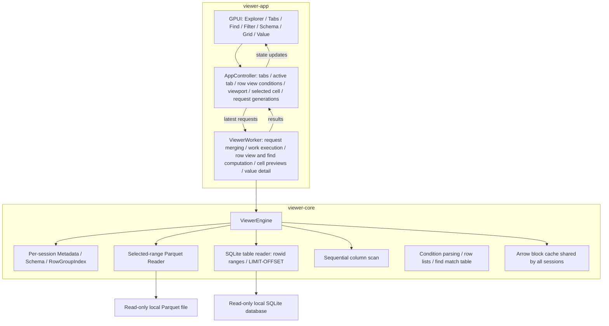

# Parquet Viewer Architecture and Implementation Plan

## 1. Product scope and technology choices

Parquet Viewer is a native desktop app that opens local Parquet files and SQLite tables read-only to explore their structure and data. The MVP consists of **the explorer, file opening, tabs, schema view, a grid virtualized over rows and columns, and value detail**, with **find, filter, sort and the file structure view** on top. The core stack is **Rust + GPUI + Arrow/Parquet**.

The app shows what the raw data looks like and how the file is stored. Statistical analysis and aggregation belong in other analysis tools. Find, filter and sort are ways to locate source rows, not features that compute values.

The first target is Windows x64, matching the current development environment. The app opens several files as tabs in a single window and activates one tab at a time. Without filter or sort, data is shown in the source file's row and column order.

| Area | Technology and role |
|---|---|
| Language and build | Rust, Cargo workspace |
| UI | GPUI used directly: windows, input, layout, text and grid rendering |
| Parquet reading | arrow-rs `parquet`: footer, schema, Row Groups, decoding selected rows and columns |
| SQLite reading | `rusqlite` with the bundled SQLite: read-only connections, schema pragmas, range queries in table order |
| Data representation | `arrow-array`, `arrow-schema`: `RecordBatch` and typed column arrays |
| Comparison and sorting | `arrow-ord`: value comparison for find and filter, and sort order |
| Local file access | `std::fs`: read-only file handles and directory listing |
| Data work execution | One dedicated `std::thread` worker running the synchronous Parquet and SQLite readers |
| Result delivery | Bounded `async-channel`; worker results are received in a GPUI task |
| Cache | Byte-budgeted LRU inside the engine; all tabs share one budget |

GPUI Kit is not a dependency. Find, filter and sort are built on the engine's sequential column scans and Arrow comparison and sort kernels; no SQL or aggregation engine is added. There is no API for modifying or saving the source file.

GPUI is pinned to an exact commit of a GitHub fork (`GreenWojaKK/zed`) that adds an `image` codec reduction and its change notice on top of a Zed release revision. The fork narrows the `image` features in Zed's root `Cargo.toml` to the gif, jpeg, png and webp that gpui uses directly or for clipboard conversion, and records the difference from upstream in a comment next to the changed lines and in `FORK.md`. GPUI source code is unchanged. Upgrading GPUI means reapplying this change and notice on the new release. The platform crates and Rust toolchain are pinned together, following that revision's Windows examples. `parquet` and the Arrow crates used directly stay on the same arrow-rs release line, and resolved dependencies are pinned in `Cargo.lock`.

## 2. User flow and screens

```text
┌─────────────────────────────────────────────────────────────────────┐
│ Open File    Open Folder               Active file name   Light Mode │
├────────────────┬──────────────────────────────────┬─────────────────┤
│ Explorer       │ [a.parquet ×][b.parquet ×] [Data|File Structure] │ Schema │
│                │ Find bar · Filter and sort bar    │ Fields · types  │
│ Expand folders │ Data Grid                        │ nullable        │
│ Select files   │ Fixed headers · sort/filter marks │ Nested fields   │
│                │ Source row numbers / visible cells├─────────────────┤
│                │ Vertical/horizontal scroll · cell │                 │
│                │ selection                        │ Value           │
│                │                                  │ Raw value       │
│                │                                  │ Nested value tree│
├────────────────┴──────────────────────────────────┴─────────────────┤
│ Active tab's path · total rows · columns · Row Groups · read state  │
└─────────────────────────────────────────────────────────────────────┘
```

### Explorer

- `Open Folder` selects the root directory. Expanding a folder lists only its direct children.
- Directories, files with the `.parquet` extension, and SQLite databases are shown. A database is a file with the `.sqlite`, `.sqlite3`, `.db`, `.db3`, `.s3db` or `.sl3` extension that starts with the SQLite header; other `.db` files are hidden. Extensions are case-insensitive.
- Expanding a database lists its tables, views and virtual tables by name. Internal `sqlite_` tables and the shadow tables of virtual tables are left out. Views are tagged `view`.
- Directories come first, then names in order within each kind. Symbolic links and directory junctions are not followed automatically.
- The expanded tree is flattened into a row list, and only visible entries are rendered.
- Double-clicking a Parquet file or a table, or selecting it and pressing Enter, opens it in a tab. A single click expands a folder or database.
- A failed folder listing shows an error and retry on that node. Grids of files already open are kept.

### Opening files

- `Open File` or `Ctrl+O` opens the native file dialog. Cancelling keeps the current state.
- A selected file with the SQLite header opens its first table or view by name, and the explorer expands the database to show the others; a database without tables shows a notice in the status bar. Any other file is validated by the Parquet reader regardless of extension. The extension filter is only the explorer's display policy.
- Opening a new source creates a new tab, activates it and starts in the `Opening` state. A source is a Parquet file, or a SQLite database and a table name. If the source is already open in a tab, that tab is activated. A SQLite tab is titled `table · file name`.
- The footer and metadata are read first to show the row count and schema, then data for the first viewport is requested.
- When a file is opened directly and the explorer has no root, its parent directory becomes the explorer root. An existing root is kept.

File and folder selection uses GPUI's `App::prompt_for_paths`. [Official API](https://docs.rs/gpui/latest/gpui/struct.App.html#method.prompt_for_paths)

### Tabs

- Each file opens in one tab. The same path is never open in two tabs.
- The tab bar above the grid shows file names and close buttons. Clicking a tab switches to it; `Ctrl+Tab` and `Ctrl+Shift+Tab` go to the next and previous tab, and `Ctrl+W` closes the active tab.
- With many tabs, widths shrink evenly down to a minimum; beyond that the tab bar scrolls horizontally. It scrolls with the mouse wheel, and scrolls to keep the active tab visible when it changes. When tabs overflow, a scroll position indicator is shown below the bar.
- Hovering a tab shows the file's full path as a tooltip, so files stay distinguishable when shrunk tabs truncate their names.
- Dropping a dragged tab on another tab moves it to that tab's slot; dropping it on empty space moves it to the last slot. While dragging, the tab at the drop slot is highlighted. Reordering keeps the active tab. Holding a dragged tab near either end of the bar keeps scrolling the bar that way, so it can be moved to slots out of view.
- The grid, schema, Value panel and status bar show the active tab's content.
- Each tab remembers its scroll position, selected cell and schema expansion. Returning to a tab requests cell data again from that state, and blocks still in the cache are shown without I/O.
- Closing the active tab activates the tab to its right, or else to its left. Closing all tabs returns to the empty state.

### Schema view

- Shows the Arrow schema's field names, data types and nullability.
- Child types of `Struct`, `List` and `Map` are shown as an expandable tree. Only expanded nodes are included in the row list.
- Grid columns are top-level fields. Expanding nested fields does not change the grid's column or row count.
- The file summary shows the total rows, top-level columns, Row Groups and file size.
- A file with zero rows still shows its schema and column headers, with an empty data state in the body.

### Data grid

- Uses fixed-height rows, fixed-width columns, and fixed header and row number areas.
- Provides vertical and horizontal scrollbars, mouse wheel, and Shift+wheel for horizontal movement.
- A click selects one cell and highlights it. The selected cell is the target of value detail.
- With the grid focused, arrow keys move the selected cell by rows and columns, Page Up/Down move by a screen, and Ctrl+Home/End go to the first and last rows.
- Cells being read show a placeholder and are updated when data arrives.
- A cell is a one-line preview of its value. Newlines, tabs and control characters become display symbols, and long values get an ellipsis at the preview length. The full raw value is shown in value detail.

### Value detail

- The Value panel shows the selected cell's value exactly as stored. Without a selected cell, it shows an empty state.
- The top of the panel shows the row number, column name, type and value size. The value size is the byte length and character count for strings, the byte length for Binary, and the element or entry count for List and Map.
- Strings are shown in full with their newlines, and Binary as a hex dump of all bytes. Any value can be scrolled to its end regardless of length.
- `Struct`, `List` and `Map` values expand into a value tree. Selecting a node in the tree shows that node's raw value in the body.
- `Ctrl+C` copies the raw value of the selected cell or node.
- The Value panel keeps its value even when the selected cell scrolls out of the grid.

### Row view

- Each tab has filter conditions and a sort key. Together they decide which rows the grid shows and in what order; this is the row view. Without filter or sort, the row view is the source file's row order.
- Grid row positions, scrolling, selection and key movement follow the row view's order. The row number area shows the source file's row numbers, and so does the Value panel.
- Changing the filter or sort makes the worker build a new row view. While it is being built, the grid keeps showing the previous row view, and the filter and sort bar above the grid shows progress and `Cancel`. When complete, the grid moves to the new row view's first row and clears the selection; the horizontal scroll position is kept. `Cancel` restores the conditions from before the change.
- The filter and sort bar is shown when there are conditions. It reads as the query text, such as `filter ( OBE_ID == "366" or ▾ OBE_ID == "977" ) and ▾ route_name == "중구01" sort -id`: each condition and the sort is a chip removed with `×`, operators are boxes with `▾`, and conditions joined by `or` are in parentheses. A long filter wraps onto more lines. `Copy Query` copies the whole query text, including the find value while the find bar is open, and `Clear All` returns to source order. The status bar shows the row view's row count together with the total.
- Each tab remembers its row view. Conditions and results survive tab switches.

### Find

- The viewer has no text input of its own. `Ctrl+F` opens the query window with the active tab's conditions and a `find` line, the cursor after `find` (on systems without the query window, the message file is pointed to). The value can also come from `Find` in a cell's context menu or from a `find` line in any query.
- The find bar above the grid shows the value being found, `Change…`, which opens the query window again, `Previous`, `Next`, the status and `×`. `Esc` in the grid closes the find bar.
- Find locates cells whose whole value exactly equals the input. It is case-sensitive and does not match partial values.
- The comparison target is the full text shown for the cell: the original text for strings, the text of the cell display contract for numbers, times and Boolean, and the same lowercase hexadecimal as the copy text for Binary. Hexadecimal input is case-insensitive. Null cells and `Struct`, `List` and `Map` cells are not find targets.
- `F3` and `Next` move to the next match, `Shift+F3` and `Previous` to the previous one. The order is the row view's row order, then column order within a row. The search starts from the selected cell and wraps around at the end.
- The found cell is selected and scrolled into view. The find bar shows the number of matching cells in the whole row view, and the grid highlights matching cells.
- `Find` in a cell's context menu puts the cell's full value into the find bar and moves to its next match.
- The first search for a new value reads the file to compute match positions. During the computation, the find bar shows progress, and grid scrolling, cell selection and tab switching keep working.
- A find sent together with new conditions runs once they are applied. `F3` while conditions are being applied shows a notice in the find bar. After a tab switch, find results are recomputed for the new tab.

### Context menus

- Right-clicking a column header opens its menu: `Sort Ascending`, `Sort Descending`, `Clear Sort` on the sorted column, `Only Nulls`, `Exclude Nulls`, and `Remove Conditions on This Column` when the column has conditions.
- Right-clicking a cell selects it and opens its menu once the cell's full value is read. A cell with a value offers conditions comparing the column with that value (`=`, `≠`, and `>`, `≥`, `<`, `≤` where the column type allows them), `Find` and `Copy Value`. A Null cell offers `Only Nulls` and `Exclude Nulls`. Nested values offer no conditions.
- Condition items act with modifier keys: Shift+click joins the column's conditions with `or`, and Alt+click adds the opposite condition (`≠` for `=`, `≥` for `<`, `≤` for `>`, `Exclude Nulls` for `Only Nulls`). While the menu is open, holding the keys changes the labels to what a click adds, such as `or == "977"` or `!= "977"`, and a note under the items says `Shift: or · Alt: not`. A condition already in the filter is marked `✓`; choosing it changes nothing.
- Conditions use the full value, not the shortened cell preview. The value text is the copy text of the cell: strings as is, Binary as lowercase hexadecimal, other values as displayed, which parses back to the same value.
- Choosing an item applies it and closes the menu. Clicking outside or `Esc` closes the menu without an action. Menu labels show values quoted, on one line, shortened after 40 characters.
- The menu is the `Menu` component of `viewer-ui`: items, items whose label and action follow the modifier keys held, disabled items, notes and separators, drawn above the window at the click position. It has no text input.

### Filter

- Conditions come from the context menus and from query text (see below).
- A filter has the shape of a spreadsheet filter: clauses that must all hold, joined by `and`. A clause is one or more conditions on one column of which at least one must hold, joined by `or` and drawn in parentheses when there are several: `(OBE_ID == "366" or OBE_ID == "977") and id >= 5 and id < 20`. So `or` joins conditions on one column only, and parentheses never nest.
- Clauses on the same column sit next to each other, in the order their columns first appear, so each column's conditions read together.
- A condition from a menu is added with `and` after the column's other clauses. With Shift it joins the column's last clause with `or`. An `=` condition on a column that already has an `=` condition joins that clause with `or` without Shift, since two different values joined by `and` match no row.
- In the filter and sort bar each operator is a small box such as `and ▾`. Clicking it opens the choice of `and` and `or` just below it. Inside parentheses, `and` splits the clause there into two; between two clauses on one column, `or` merges them. Between clauses on different columns `or` is grayed out with the note `or joins conditions on one column only`.
- Dragging from a condition's text across others sweeps a range of conditions in reading order, across wrapped lines too. The swept chips are highlighted, and the line under the conditions says what releasing does: `Release to join 3 conditions with or`, or, when the range covers another column, red chips and `or joins conditions on one column only`. Releasing over the conditions makes the range exactly one clause, joined by `or` inside and by `and` to the conditions just outside it, so sweeping part of a clause splits it. A range of one condition or of several columns changes nothing. Leaving the conditions shrinks the range back to its start, and releasing elsewhere or pressing `Esc` drops the sweep. The `▾` boxes do the same edits one join at a time.
- The engine computes each condition as a Boolean per row with Null cells false, folds each clause with `|` and the clauses with `&`. Only columns with conditions are read.
- Operators depend on the column type:

| Column type | Operators |
|---|---|
| String | `=`, `≠`, `contains`, `<`, `≤`, `>`, `≥`, `null`, `not null` |
| Boolean, integer, float, Decimal, Date, Time, Timestamp | `=`, `≠`, `<`, `≤`, `>`, `≥`, `null`, `not null` |
| Binary | `=`, `≠`, `null`, `not null` |
| `Struct`, `List`, `Map` and other types | `null`, `not null` |

- Values of comparison operators are parsed as the column type and compared by value. For example, `= 1.5` on a Decimal column matches `1.50`. A value that cannot be parsed is not applied, and the filter and sort bar shows the reason.
- String comparison and `contains` are case-sensitive. String `<` and `>` use UTF-8 byte order. Binary values are entered as hexadecimal.
- Comparison operators and `contains` never match Null cells. Null cells are selected with the `null` operator.
- Columns with a filter show their header name in the accent color.

### Sort

- Each header click cycles ascending, descending, then no sort. The header's context menu sets a direction or clears the sort directly. The sort key is a single column; clicking another column's header switches to ascending on that column. The header shows the direction with `▲` or `▼`.
- With a filter, only rows that pass the filter are sorted.
- Null goes last regardless of direction. Rows with equal values keep the source file's order.
- Strings sort by UTF-8 byte order, and floating-point NaN sorts as the largest value.
- Columns of `Struct`, `List`, `Map` and types without display support are not sorted. Clicking such a header shows a notice in the filter and sort bar that the column cannot be sorted.

### Query text

A query is the text form of a row view and a find value, one command per line. The filter and sort bar shows conditions in this form, context menus label their items with it, and `Copy Query` writes it.

```text
find 홍길동
filter age >= 30 and status == "활성"
sort -created_at
```

- `find <value>` finds cells whose whole value equals the value.
- `filter <expression>` keeps rows for which the expression holds. Conditions are joined with `and`, and conditions on one column also with `or`, in the shape of the filter above. One level joins with one word, so mixing `and` and `or` takes parentheses: `filter (a == 1 or a == 2) and b == 3`. A line of `or` alone needs none: `filter a == 1 or a == 2`. Several `filter` lines combine with `and`.
- `or` between different columns, `and` inside `or`, and mixing without parentheses are errors that point at the place, such as ``line 1, column 20: `or` joins conditions on one column only; this one is on status, not age``.
- A written query puts each clause of several conditions in parentheses, as the bar shows it.
- Conditions are `<column> <op> <value>` with `==`, `!=`, `<`, `<=`, `>`, `>=` or `contains`, or `<column> is null` and `<column> is not null`. `=` is read as `==`. Operators follow the column type as in the filter table above.
- `sort <column>` sorts ascending and `sort -<column>` descending, by one column. A query has at most one `find` and one `sort` line.
- Values without spaces are written as is; others are quoted as `"…"` with `\"`, `\\`, `\n`, `\t` and `\r` escapes. Other backslashes stay as written, so Windows paths read back unchanged. Values of string columns are always written quoted.
- Column names with spaces or symbols are written in backticks, with a backtick inside doubled: `` `운행 일자` ``. Names must match exactly; a name that differs only in case is suggested in the error.
- Keywords are case-insensitive and blank lines are ignored. A query states the whole view: a missing line means no find, filter or sort, and an empty query clears them.
- Values are parsed as their column types with the same rules as conditions from the menus. An error names the line and character column and the reason, such as ``line 1, column 8: this `(` is not closed``.
- Writing a query and reading it back gives the same conditions, sort and find value.

### Query input and log

Queries reach a tab in three ways, all applied the same way and logged the same way.

| Way | For |
|---|---|
| Context menus and header clicks | Quick changes with the mouse |
| Query window (Windows) | A person writing a query, such as `contains` or a value not on screen |
| Message file | Agents and other programs, and systems without the query window |

- A query text states the whole view of the active tab: its conditions, sort and find value replace the current ones. A text that does not parse changes nothing; the reason, with line and column, is shown on a line of its own in the filter and sort bar and in the query window's status.
- A find sent with new conditions runs once their row view is applied, since find works on finished row views.
- The toolbar's `Query` menu has `Write Query…`, `Copy Query`, `Copy Message File Path` and `Open Query Log Folder`. The context menus of headers and cells also have `Write Query…`.

The query window is the `InputWindow` of `viewer-ui`, a small window of the operating system.

- It holds the system's multi-line edit control, so typing, Korean IME composition, clipboard and undo are the system's. It opens over the viewer, owned by it, filled with the active tab's current query; opening it again refills it and brings it to the front.
- `Ctrl+Enter` or `Apply` applies the text and keeps the window open; `Esc` or `Close` closes it. The status line shows `Applied · 352 of 280,797 rows` once the row view is applied, or the error.
- The window runs on its own thread with its own message loop, which also gives `Tab` between its controls. The viewer's thread never waits for that thread: showing a window that has an owner sends messages to the owner's thread, so waiting there would never end. Requests made before the window exists, such as a new status, are applied as soon as it does.

The message file is the `Inbox` of `viewer-ui`.

- Each running viewer has its own file, `%LOCALAPPDATA%\TPUI\inbox\<process id>.txt` (`~/.local/state/tpui/inbox/` elsewhere), created empty at start. `Copy Message File Path` copies its path.
- The file is checked every 0.5 seconds. A change is applied once the file has stayed the same for one more check, which skips the empty file a writer leaves between truncating and writing. A UTF-8 byte order mark is dropped and `\r\n` line ends are read as `\n`.
- The file is removed when the viewer quits. Files of viewers that ended without quitting are removed when the next viewer starts.

Every applied query goes to the query log, `%LOCALAPPDATA%\TPUI\query-log\<date>.jsonl`, one JSON line per query.

- A line holds the local time, the source file and SQLite table, the origin (`click`, `window` or `file`), the whole query text, and the row count of the resulting row view or the error. A text that does not parse is logged as received, with its error.
- A query that starts a row view computation is logged when the computation ends. A computation replaced by a newer query before it ends is not logged, and a click that leaves the query unchanged is not logged again.
- Lines are only appended; the log is never rewritten or trimmed. The log stays in the app's own folder, never next to the data. Queries can contain cell values, so the log can hold personal data from the files viewed; `Open Query Log Folder` shows where it is, and the user deletes it when they want to.

### File structure

- `Data` and `File Structure` at the right of the tab bar switch the tab body. Each tab remembers its last choice. `Ctrl+F` in the file structure returns to the data and opens find.
- The file structure shows only the information in the Parquet metadata. No data pages are read, so it appears immediately regardless of file size.
- The top shows the file summary: Parquet format version, the program that wrote the file, compressed and uncompressed data size and ratio, and the keys and value sizes of the key-value metadata.
- The middle table shows, per leaf column, the path, physical and logical type, codec, compressed and uncompressed size, ratio, null count, min, max, and whether a page index and Bloom filter exist. Hovering a cell shows truncated content in full and the list of encodings as a tooltip.
- The bottom table shows, per Row Group, the row count, compressed and uncompressed size, and ratio. The first row, `All`, is the total over all Row Groups. Selecting a Row Group switches the middle table to that Row Group's information.
- Min and max convert per-Row-Group statistics to Arrow types for comparison and are shown in the same format as the cell display contract. Approximations truncated in the file get a `≈` prefix. Without statistics, or for leaves of nested columns, `-` is shown. Null counts are summed only when every Row Group records them.

### Table structure

- For a SQLite tab, the structure button reads `Table Structure`. It shows the schema and pragmas of the table; no rows are read.
- The top shows the kind (table, view or virtual table, with `WITHOUT ROWID` and `STRICT`), the row count, the row order, and the database: file size, page count and size, text encoding and journal mode.
- The column table shows, per column, the name, declared type, the Arrow type the grid shows it as, the storage classes found in it, `NOT NULL`, the default and the primary key position.
- The bottom shows the indexes (name, columns, uniqueness, origin and whether partial, with the `CREATE INDEX` statement as a tooltip) next to the table's `CREATE` statement.

### Theme

- Colors come in a light and a dark set. At startup the app follows the Windows app color setting and keeps following its changes. The toolbar's `Light Mode` / `Dark Mode` button switches the theme, after which the app no longer follows the setting until restart.
- The viewer uses the default theme of `viewer-ui`. Sizes and colors used only by the viewer's own views, such as grid and tree sizes and the find highlight, live in `viewer-app`.

## 3. Components and dependencies

The Cargo workspace consists of three crates.

| Crate | Role | Depends on |
|---|---|---|
| `viewer-core` | Parquet and SQLite reading, row views, find, query text, file and table structure. No GPUI dependency | arrow-rs, parquet, rusqlite |
| `viewer-ui` | UI components shared by GPUI apps: light and dark themes, context menu, query window of the operating system (Windows), message file, tab bar, tables with fixed or wrapping rows, small buttons, line, bar and strip charts, heatmap, route map, number and size formats. No dependency on the data engine | GPUI |
| `viewer-app` | The Parquet viewer app. Combines the two crates and owns the worker and screen state | `viewer-core`, `viewer-ui`, GPUI |

### Shared theme

`viewer-ui` separates what components do from how they look. Components name the role of each color they draw and the sizes they follow; an app supplies the values.

- `Theme` holds a dark and a light `Palette`, `Metrics` and `Fonts`. Without `theme::install`, the default theme is used.
- Palette roles: background, surface (panels, bars, table headers), overlay (tooltips, menus, popovers), border, text, muted text, missing (null values and missing bars), error, selection, hover, button, button hover, accent, grid line, chart track, scrollbar track and thumb, drop target.
- Metrics hold sizes several components follow together: the fixed table row height, the panel header height (including the tab bar), table cell padding, wrapping row padding and button padding. Geometry of one component stays with that component: tab sizes in the tab bar, bar thickness, track thickness and point size as chart options.
- Fonts: the UI font and the monospace font. The defaults are Segoe UI and Consolas on Windows and DejaVu Sans and DejaVu Sans Mono elsewhere.
- An app starts from `Theme::default()`, changes the fields it needs and calls `theme::install` once, before anything is drawn. The theme types are `#[non_exhaustive]`, so roles added later do not break an app's theme. Installing after the theme has been read panics, because the default theme is already in use.
- There is one color mode per process. `theme::mode` and `theme::set_mode` switch between the two palettes, and color functions read the mode on every paint. Colors of an app's own views come from `theme::pick(dark, light)`.
- A strip chart cannot know what lies behind it, so the ring that separates overlapping points takes its color from `StripChart::background`, by default the surface color.

GPUI apps in other repositories use `viewer-ui` as a git dependency. Such an app depends on the same GPUI fork commit as `viewer-ui`; with a different commit, GPUI is built twice and the types do not match. When GPUI is upgraded, this repository moves first and the apps follow its commit.



| Component | Responsibilities and owned state |
|---|---|
| `AppController` | Tab list and active tab, issuing `SessionId` and `RequestId`, the active tab's latest `RequestId` per viewport, value and find request, error display, theme following |
| Tab state | Per tab: path, `SessionId`, file state, grid scroll position, selected cell, schema expansion, applied row view conditions with their `ViewId` and row count, conditions being built |
| `TabBar` (`viewer-ui`) | Tab titles, active marker, switch, close and reorder input |
| `FindBar` | Value being found, matching cell count and progress, previous and next |
| `Menu` (`viewer-ui`) | Items of an open context menu and their actions |
| `InputWindow` (`viewer-ui`, Windows) | The query window's thread, edit control, status line and requests from the viewer |
| `Inbox` (`viewer-ui`) | The message file of the process and the last version delivered |
| `QueryLog` | The folder of the daily query log files |
| `ViewBar` | The row view's filter and sort conditions as query text with operator boxes and the parentheses of `or` clauses, sweeping conditions into parentheses, query copy, progress and cancel, notices for unsortable columns |
| `StructureView` | The active tab's file structure, the selected Row Group and its column information, or the table structure of a SQLite tab |
| `ExplorerView` | Root path, expanded folders and databases, selected file or table, directory and database listing state |
| `SchemaView` | The active tab's schema nodes and expansion state |
| `GridView` | The active tab's logical scroll position, visible row and column ranges, cell previews and source row numbers, sort and filter marks in headers, input and rendering |
| `ValueView` | Value tree nodes and expansion, selected node, body value and display line index, body scroll position |
| `ViewerWorker` | Handling open and close commands, picking the latest requests, calling the engine, checking result generations, bounded text conversion of Arrow values, holding the selected value and building detail and copy text, holding per-session row lists and mapping row view positions to source rows, row view and find computation tasks |
| `ViewerEngine` | Per open session: file handle, metadata, Row Group index; read planning, decoding, sequential column scans, arbitrary row reads, and the cache shared by all sessions |

Public types of `viewer-core` consist of Rust standard and Arrow types. GPUI's `Entity`, `Context` and `Window` are used only inside `viewer-app`. The app requests data through the engine's public API, and GPUI layout and paint callbacks only read screen state that is already prepared.

`ViewerWorker` runs the data engine. Explorer directory listings run as separate GPUI background tasks, and in-flight requests for the same folder are merged. When the explorer root changes, responses for the previous root are dropped.

### Charts, heatmaps and maps

Charts and maps in `viewer-ui` are drawn directly as GPUI custom `Element`s. No chart or map library is used.

- `LineChart` takes x and y axes and a list of layers. Layers are bands (`Band`), lines (`Line`) and rules (`Rule`), drawn in insertion order. Prediction intervals are stacked bands, medians and actuals are lines, and nominal values and diagonals are rules.
- `Heatmap` colors row × column cells with a diverging color scale centered at 0, and draws a color scale bar with its bounds on the right.
- `BarChart` draws horizontal bars, one group per row and one bar per series. Bars start at 0 and the scale ends at the largest value unless the caller sets it. Values are written in a column at the right; a missing value leaves a hatched track and the series' missing label. `legend()` builds the series swatches for the caller to place.
- `StripChart` places points on a shared horizontal axis, one row per category, such as the times buses pass a stop. Point labels alternate above and below the track, axis ticks are marked on every track and labeled under the last row, and markers are dashed vertical lines across all rows with an optional label above them. Points outside the axis range are not drawn, and a row without points can show an empty label.
- Bar and strip charts put row labels in a left column at most a fixed share of the width wide, wrapped at spaces. Their height follows their rows: they request a measured layout and compute the row heights from the width they are given.
- Rectangular plot frames, grid lines, guides, point markers, heatmap cells, the color scale, bars, tracks and strip points use `paint_quad`. Bands use `PathBuilder::fill`, joining the upper bound forward and the lower bound backward into a closed path; lines, rules, strip markers and the hatching of missing bars use `PathBuilder::stroke`. Dashes use `dash_array`.
- Bands and lines break at missing points. Points without neighbours are drawn as circles.
- Axis ticks are either given by the caller or placed automatically within the range at 1·2·2.5·5×10ⁿ steps. Automatic tick labels use the fewest decimals that can express the step.
- Text is drawn with `shape_line`, and the plot area is clipped with a content mask so layers do not spill outside the frame.
- On hover, a line chart reports the index of the nearest point, a heatmap the cell's row and column, a bar chart the bar's row and series, and a strip chart the row and index of the point within reach of the mouse. The caller updates its state and passes back the guide or highlight position.
- Charts compute no values. The caller passes values that are already computed.

`GeoMap` draws background areas, routes, markers and labels at `[latitude, longitude]` coordinates, without map tiles.

- The projection is equirectangular around the center latitude of the fitted region. The view fits the routes, markers and labels with a padding, keeps the aspect ratio and centers them; areas are background and do not affect the fit.
- Areas are filled with `PathBuilder::fill` using the even-odd rule, so holes need no particular winding, and outlined with `PathBuilder::stroke`. Routes are strokes with bevel joins and optional dashes; markers are circles drawn with `paint_quad`; labels are shaped lines with an optional halo drawn as offset copies under the text.
- Area geometry is prepared once per view: areas whose bounds miss the element are skipped, rings are clipped to the element plus a margin (Sutherland–Hodgman), vertices are snapped to the device pixel grid and repeated points are removed. Every area snaps to the same grid, so the shared borders of neighbouring areas stay coincident. The snapping error is at most half a device pixel.
- The tessellated area paths are kept in element state, keyed by the area set (`Arc` identity), the view, the device scale and the border width. Each frame only moves the cached paths to the element's position; colors are applied at paint time, so a theme change reuses the geometry.
- On real analysis runs (55 areas with 29,060 vertices, 8 maps at 1067 × 710 px and scale 1.5), preparation keeps on average 35 areas and 5,234 outline vertices and takes about 2 ms; tessellating every area on every frame takes about 6.9 ms, while reusing the prepared paths takes about 0.06 ms per frame.

### Wrapping text and tables

GPUI's own text wrapping may break between any two Hangul syllables and split a word. `WrappedText` wraps only at whitespace and newlines, the way CSS `word-break: keep-all` sets Korean text; no-break spaces join their neighbours, and only a word wider than the whole line is broken between graphemes. It fills its parent's width and requests a measured layout, so its height follows its line count. Line widths are measured with `layout_line`, whose results GPUI caches across frames.

`table::row` has a fixed height for `uniform_list`, and text that does not fit is truncated and shown in a tooltip. `table::wrapped_row` puts each cell in a `WrappedText`, so a row grows to fit its longest cell; it is for short tables of sentences laid out in an ordinary column. Table functions take column names as `&'static str` or as `SharedString` known only at run time.

### Directory layout

```text
TPUI/
├── architecture.md
├── Cargo.toml
├── Cargo.lock
├── rust-toolchain.toml
└── crates/
    ├── viewer-app/
    │   ├── Cargo.toml
    │   ├── build.rs
    │   ├── app.rc
    │   ├── assets/
    │   │   ├── app.ico
    │   │   └── logo.png
    │   └── src/
    │       ├── main.rs
    │       ├── app.rs
    │       ├── worker.rs
    │       ├── cell_preview.rs
    │       ├── value_detail.rs
    │       ├── query_log.rs
    │       └── ui/
    │           ├── explorer.rs
    │           ├── schema.rs
    │           ├── grid.rs
    │           ├── value.rs
    │           ├── find_bar.rs
    │           ├── view_bar.rs
    │           ├── structure.rs
    │           └── style.rs
    ├── viewer-ui/
    │   ├── Cargo.toml
    │   ├── src/
    │   │   ├── lib.rs
    │   │   ├── theme.rs
    │   │   ├── tab_bar.rs
    │   │   ├── table.rs
    │   │   ├── widgets.rs
    │   │   ├── wrap.rs
    │   │   ├── chart.rs
    │   │   ├── bars.rs
    │   │   ├── strip.rs
    │   │   ├── heatmap.rs
    │   │   ├── map.rs
    │   │   ├── menu.rs
    │   │   ├── input_window.rs
    │   │   ├── inbox.rs
    │   │   ├── storage.rs
    │   │   └── format.rs
    └── viewer-core/
        ├── Cargo.toml
        ├── src/
        │   ├── lib.rs
        │   ├── model.rs
        │   ├── engine.rs
        │   ├── reader.rs
        │   ├── row_index.rs
        │   ├── cache.rs
        │   ├── scan.rs
        │   ├── condition.rs
        │   ├── row_view.rs
        │   ├── query.rs
        │   ├── filter.rs
        │   ├── sqlite.rs
        │   ├── find.rs
        │   ├── structure.rs
        │   └── error.rs
        └── tests/
            ├── reader_contract.rs
            ├── sqlite_contract.rs
            └── view_contract.rs
```

## 4. Engine API and data contracts

The public API is a synchronous Rust API called within the same process. The worker decides when it is called.

| API | Input | Result and behavior |
|---|---|---|
| `open` | `SessionId`, `Path` | Opens a read-only handle and metadata, adds it as a session and returns `DatasetInfo`. Other sessions are kept |
| `open_sqlite` | `SessionId`, `Path`, table name | Opens a read-only connection to the table or view, reads its row count, storage classes and block keys (see section 5), adds it as a session and returns `DatasetInfo` |
| `open_source` | `SessionId`, `DataSource` | Calls `open` or `open_sqlite` |
| `plan_window` | `WindowRequest` | Splits the rows and columns intersected with the file range into `BlockRequest`s per Row Group |
| `read_block` | `BlockRequest`, cancellation state | Looks up the cache or decodes the selected range and returns a `DecodedBlock` |
| `read_value` | `ValueRequest`, cancellation state | Finds the block holding the target cell in the cache or decodes it, and returns a `ValueSlice` holding only that cell |
| `read_rows` | `SessionId`, source row list, column list, cancellation state | Finds each row's block in the cache or decodes it, and returns a `RecordBatch` gathered in row list order |
| `file_structure` | `SessionId` | Returns a `FileStructure` built from metadata alone: file summary, per-Row-Group sizes, and per-leaf-column storage information over all Row Groups |
| `row_group_columns` | `SessionId`, Row Group position | Returns that Row Group's per-leaf-column storage information |
| `table_structure` | `SessionId` | Returns the `TableStructure` of a SQLite session: kind, row order, columns with declared types and storage classes, indexes, `CREATE` statement and database pragmas |
| `scan` | `SessionId`, column list, optional ascending source row list | Returns a sequential column scan, `ColumnScan`. Each call returns the next batch in source order. With a row list, only those rows are read. The cache is not used |
| `close` | `SessionId` | Releases that session's file handle, metadata, index and cache entries |

`DatasetInfo` holds the `SessionId`, `DataSource`, path, file size, total rows, `SchemaRef`, and row count per Row Group; a SQLite table is one group holding all rows. `sqlite_objects(path)` lists the tables and views of a database, and `is_sqlite_file(path)` checks the header. `DecodedBlock` holds the `SessionId`, file-level start row, actual row count, source column IDs and the `RecordBatch`. `ValueSlice` holds the `SessionId`, global row, `ColumnId`, source `Field`, and an Arrow array of length 1 holding the target cell.

The core request types follow this contract:

```rust
pub struct SessionId(pub u64);
pub struct RequestId(pub u64);
pub struct ColumnId(pub usize); // position of a top-level field in the source schema

pub struct WindowRequest {
    pub session: SessionId,
    pub request: RequestId,
    pub rows: std::ops::Range<u64>,
    pub columns: Vec<ColumnId>,
}

pub struct ValueRequest {
    pub session: SessionId,
    pub request: RequestId,
    pub row: u64,
    pub column: ColumnId,
}

pub enum FilterOp { Eq, NotEq, Contains, Lt, LtEq, Gt, GtEq, IsNull, IsNotNull }

pub struct FilterCondition {
    pub column: ColumnId,
    pub op: FilterOp,
    pub value: String, // text typed by the user, parsed as the column type
}

pub struct SortKey {
    pub column: ColumnId,
    pub descending: bool,
}

pub struct ViewSpec {
    pub filters: Vec<FilterCondition>, // one per column
    pub sort: Option<SortKey>,
}
```

- Engine row numbers are zero-based and ranges are `[start, end)`. Only on-screen row numbers start at 1.
- Total rows and row positions stay `u64`. Only validated ranges are converted to `usize` for access within a batch.
- Requested columns are sorted into source schema order and deduplicated. Out-of-range column IDs are returned as errors.
- Row ranges are intersected with `[0, total_rows)`. An empty intersection is an empty result with no I/O. `start > end` is a request error.
- A `ValueRequest` row outside `[0, total_rows)` is a request error.
- Column IDs in responses link source fields to positions in the projected batch. Column names are not used as identifiers.
- Requests for sessions that are not open end with `StaleSession`.

## 5. Opening files and reading selected ranges

### Metadata-first open

1. Open the file with `std::fs::File::open`.
2. Read the footer and Parquet metadata and build the Arrow schema.
3. Build cumulative offsets from the row counts per Row Group.
4. Send `DatasetInfo` to the UI to show the schema and file summary.
5. Decode the data blocks needed for the first viewport request.

Metadata is reused for the whole file session. `ParquetRecordBatchReaderBuilder::new_with_metadata` builds a reader from metadata already read. [Official API](https://docs.rs/parquet/latest/parquet/arrow/arrow_reader/type.ParquetRecordBatchReaderBuilder.html#method.new_with_metadata)

### Row Group index

With `G` Row Groups of `n[i]` rows each, build a cumulative array of length `G + 1`.

```text
offsets[0] = 0
offsets[i + 1] = offsets[i] + n[i]
total rows = offsets[G]
```

Global row `r` belongs to the Row Group satisfying `offsets[i] <= r < offsets[i + 1]`. It is found by upper-bound binary search, and the row within the group is `r - offsets[i]`. Row Groups with zero rows are skipped by the same rule. The cumulative sum uses checked arithmetic.

Building the index is `O(G)`, and looking up a single row's group is `O(log G)`. In the MVP the cumulative sum over metadata sizes is computed on the CPU.

### Decoding unit

The read unit is **at most 512 rows within one Row Group × the requested set of top-level columns**. Block starts are aligned to 512-row boundaries within the Row Group. The last block is cut at the group's end.

1. Split the requested row range into intervals per Row Group.
2. Select the blocks overlapping each interval, processing blocks that overlap the current viewport first.
3. Select one Row Group with `with_row_groups`.
4. Specify the set of top-level columns with `ProjectionMask::roots`.
5. Specify the block within the group with `RowSelection` skip/select runs and read with `with_batch_size(512)`.
6. The worker builds previews of the cells actually needed and sends them to the UI.

`with_row_groups` is applied before `RowSelection`, so selection row positions are relative to the selected Row Group. [Reader API](https://docs.rs/parquet/latest/parquet/arrow/arrow_reader/struct.ArrowReaderBuilder.html#method.with_row_selection)

Top-level field projection is distinct from leaf projection of nested fields. `ProjectionMask::roots` includes the child columns of the requested top-level fields. [ProjectionMask API](https://docs.rs/parquet/latest/parquet/arrow/struct.ProjectionMask.html#method.roots)

Decompressing and decoding a Parquet page can process more data than the requested rows. Blocks therefore run sequentially, and the cancellation state is checked before and after each batch. Files without a Page Index follow the same read contract.

### Single value lookup

`read_value` picks the block holding the target row with the same rules as block reads.

1. Find a cache entry with the same Row Group and block start that includes the target column.
2. Otherwise, read a block projecting only the target column and insert it into the cache.
3. Copy just the target cell from the block batch into a new array of length 1 and return it as a `ValueSlice`. The returned value does not keep the whole block's buffers alive.

Parquet does not decode part of a single value, so the selected value is fully in memory after decoding. The display cost of large values is bounded by virtualizing display lines in value detail.

### SQLite tables

A SQLite table is addressed like a Parquet file with one Row Group: rows are positions in a fixed row order, and blocks, value reads, row reads, scans, row views and find use the same contracts. Filter, sort and find run the shared Arrow computation over scans of the table, so their rules (Null last, UTF-8 byte order, whole-value matches) are the same for both formats; SQLite's own comparison and collation rules are not used.

- Row order: rowid order for ordinary tables and virtual tables with a rowid, primary key order for `WITHOUT ROWID` tables, and the order SQLite returns for views and other virtual tables. The rowid is reached as `rowid`, `_rowid_` or `oid`, whichever no column shadows.
- Opening runs in one read transaction: one query counts the rows and collects, per column, the storage classes present (`integer`, `real`, `text`, `blob`); for rowid order, a scan of the rowids records the rowid at every 512th row. The transaction ends before the session starts.
- Column types follow the storage classes found: integers only → Int64; reals, or integers and reals → Float64; text only → Utf8; blobs only → Binary; any other mix → Utf8, where integers and reals are written as SQLite-style text and blobs as `x'…'` literals. A column without values takes the type of its declared affinity. The declared type is kept in the field metadata (`sqlite.declared_type`).
- A block in rowid order is `WHERE rowid >= block key ORDER BY rowid LIMIT 512`; other orders use `LIMIT`/`OFFSET`, whose cost grows with the offset. Scans continue from the last rowid read, or by offset. A scan with a row list reads each block holding listed rows once.
- Connections are opened read-only with `query_only`. No transaction is held between reads, so writers are never blocked. Readers of a WAL database update its `-shm` shared-memory file as SQLite requires; the database and WAL files are not written.
- The size and modification time of the database file and its `-wal` file are compared before reads. A change, a row count that no longer matches, or a value whose storage class the column type cannot hold ends the read with `FileChanged`, and the tab offers reopening.

## 6. Virtualized grid

### Viewport computation and rendering

`GridView` stores `first_visible_row: u64` and a pixel offset within that row. It never creates a huge GPUI element of total rows times row height; cells are placed in coordinates relative to the viewport. The vertical scrollbar's position ratio is computed in `f64`, and row-wise key input updates the integer row position.

The horizontal position is likewise stored as the first column ID and an offset within that column. The visible column range is computed from the fixed column width. Header and body share the horizontal position, and the row number area stays fixed during horizontal movement.

- 8 rows above and below and 1 column left and right of the viewport are requested as overscan.
- The number of cells built and formatted for the grid is proportional to the viewport plus overscan rows × columns.
- When scrolling or resizing changes the requested range, the latest `WindowRequest` is registered. An unchanged range is not requested again.
- Existing cells overlapping the current screen are kept, and only newly exposed cells show placeholders.
- The grid implements layout, hitboxes and paint as a GPUI custom `Element`. The explorer's and schema's fixed-height row lists use `uniform_list`. [Element API](https://docs.rs/gpui/latest/gpui/trait.Element.html), [uniform_list API](https://docs.rs/gpui/latest/gpui/fn.uniform_list.html)

### Cell display contract

A cell preview is a summary for drawing in the grid, built by the worker. GPUI rendering uses only the preview's text and style. Anything omitted or summarized in a preview is shown in full in value detail.

| Data | Display |
|---|---|
| Null | Dedicated `null` style, distinct from the empty string |
| Boolean, integer, float, Decimal | Value appropriate to the type, keeping the Decimal scale |
| Date, Time, Timestamp | Value and precision kept; Timestamp timezone shown when present |
| String | Preview of at most 256 Unicode scalar values with an ellipsis |
| Binary | Hexadecimal preview of the first 32 bytes and the total byte length |
| Struct | `Struct {field count}` summary |
| List, Map | Element or entry count summary |
| Dictionary | Displayed by the type of the referenced values |
| Types without display support | Type name and a `display unsupported` state |

Strings copy only the prefix they need, and nested values get a summary. Timestamps without timezone information are never converted to an arbitrary local timezone. Decoding errors are handled as data read errors, distinct from unsupported cells.

## 7. Value detail

Grid cells are previews for drawing. Inspecting and copying raw values is the job of value detail, which shows the whole value regardless of length and shape.

### Data flow

1. When the selected cell changes, `AppController` registers a `ValueRequest` under a new `RequestId`.
2. The worker handles the value request after processing the current viewport's blocks. A selected cell within the viewport is found in the cache.
3. The worker keeps the `ValueSlice` returned by `read_value` as the selected value and sends the root node's detail model to the UI.
4. Expanding a nested node makes the UI request its children, addressing the node by its child positions from the root. The worker builds child nodes from the selected value.
5. Selecting a node makes the worker send that node's full raw value to the UI: a text copy for strings, a byte copy for Binary, and the display text for other scalars.

Switching tabs releases the previous tab's selected value. If the new active tab has a selected cell, its value is requested again.

### Value tree and body

| Data | Value tree node | Body |
|---|---|---|
| Null | Dedicated `null` style | Dedicated `null` style, distinct from the empty string |
| Boolean, integer, float, Decimal, Date, Time, Timestamp | Same text as the cell display contract | Same text as the cell display contract |
| String | One-line preview and character count | Full original text |
| Binary | Hexadecimal preview of the beginning and the byte length | Hex dump of all bytes: offset, 16 bytes in hexadecimal and ASCII per line |
| Struct | Child node per field name | Field count summary |
| List | Child node per element position | Element count summary |
| Map | Child node per entry, with key and value nodes under each entry | Entry count summary |
| Dictionary | Node by the type of the referenced values | Body by the type of the referenced values |
| Types without display support | Type name and a `display unsupported` state | Text from `arrow-cast`'s display formatter; if the formatter does not support it either, the type name and a `display unsupported` state |

- Scalar cells show only the body, without a value tree.
- Nodes with more than 1,000 children group them into range nodes of 1,000. Expanding a range node builds only the children in that range.

### Body display

- The body uses a monospace font. String newlines (`\n`, `\r\n`, `\r`) split lines, and tabs and other control characters are shown as display symbols. Lines wider than the panel wrap at the panel width.
- Display symbols and wrapping apply only to the screen. The raw value and copy results are unchanged.
- The UI builds an index of the body's display line starts in a GPUI background task and rebuilds it when the panel width changes. While building the index, the body shows `Loading`.
- The body renders only visible lines with a `uniform_list` of display lines. A hex dump has one line per 16 bytes, so positions are computed from line numbers without an index.

### Copy

With the grid focused, the selected cell's value is copied; with the Value panel focused, the selected node's value. The worker builds the copy text from the selected value and the UI writes it to the clipboard. Preview text is never used for copying.

| Data | Copy text |
|---|---|
| String | The original text as is |
| Binary | Lowercase hexadecimal without spaces |
| Null | `null` |
| Other scalars | The body text |
| Struct, List, Map | JSON: Struct as an object, List as an array, Map as an array of `{"key": …, "value": …}` objects. Nested Binary as hexadecimal strings, and NaN, Infinity and time values as strings |

Copying a large value builds text as large as the value. Text building runs on the worker and does not block the UI thread.

## 8. Row views and find

### Sequential column scan

`ColumnScan` reads only the requested top-level columns in Row Group order and returns batches of at most 8,192 rows. With an ascending source row list, each Row Group is read with a `RowSelection` holding only those rows, and Row Groups without listed rows are not opened. Each batch is returned with the position in the row list, or in the file, of its first row.

Scans bypass the cache and do not keep the batches they return. The file size and modification time are checked at the start of each Row Group.

### Row lists

A row view is represented by row lists, arrays of source row numbers. When the total row count fits in `u32`, each row uses 4 bytes; otherwise 8 bytes. Without filter or sort, no row list is built.

- Filtered rows: source rows that passed the filter, in ascending order. Built only with a filter.
- Display order: source rows in sorted order. Built only with a sort; it holds all rows with a sort alone, or the filtered rows when there is also a filter.

Row i of the row view is the i-th entry of the display order if it exists, otherwise the i-th filtered row, otherwise the i-th source row.

### Filter computation

1. Parse each condition's value as the column type: string columns use the input as is, Binary as hexadecimal, and other types through `arrow-cast` string conversion. Dictionary columns are parsed as the type of their values.
2. Read only the columns with conditions using a sequential scan.
3. For each batch, build a Boolean result per condition, turn Null results into false, and AND them all. Comparisons use `arrow-ord` comparison kernels, and `contains` uses string search.
4. Append the source numbers of true rows to the filtered rows.

### Sort computation

1. Read the sort column with a sequential scan, over the filtered rows if present, otherwise over all rows. Dictionary values are collected as arrays of their referenced values.
2. Concatenate the collected values into one array and run `lexsort_to_indices` keyed by `(sort value, position within the row view)`. The sort value uses the requested direction with Null last, and the position is ascending, so rows with equal values keep source order.
3. Map the resulting positions to source row numbers to build the display order. The sort value array is released when the computation ends.

The number of rows to sort must fit in `u32`. Otherwise the sort is not performed and a notice is shown.

### Reading the screen of a row view

A row view in source order reads the visible range with block reads. With a row list, the worker takes the source row numbers of the visible range, reads them with `read_rows`, and sends the source row numbers to the UI along with the cell previews. `read_rows` also uses the block cache. In a sorted row view, the visible rows are scattered across blocks, so the blocks read for one screen can grow up to the number of visible rows.

Value requests are sent as row view positions, and the worker maps them to source rows before calling `read_value`.

### Find computation

1. Parse the input into a comparison value per column. String columns use the input as is, and Binary columns parse it as hexadecimal. Other scalar columns parse the input as the column type, convert it back to the cell display text, and become comparison targets only when that text equals the input. Each value has exactly one display text, so comparing values equals comparing display texts. Columns without a comparison target are not read.
2. Read the target columns of the row view's rows (the filtered rows if present) with a sequential scan. Mark source rows with matching cells in a bitmap and count the matching cells. The bitmap has 1 bit per source row.
3. For the next or previous match, look first at the following columns in the start cell's row, then scan the bitmap in row view order for a matching row. The found row's target columns are read with `read_rows` to pick the first matching column (the last one for a previous match).

Find results are reused when the session, row view and input are all the same. The worker keeps only the most recent result. To highlight matching cells in the grid, the visible range request carries the find input, and the worker marks matches with the same comparison while building previews.

### Running computation tasks

Row view and find computations run on the data worker thread, split into batches. After each batch, the worker checks the mailbox and handles open, close, visible range and value requests first. Scrolling, cell selection and tab switching therefore keep working during computation, and only one decoding job runs at a time.

- Each session keeps only its latest row view request. A new request, cancel or tab close on the same session drops the in-flight computation. Computations of different sessions run in order.
- Only the active tab's latest find request is kept. If a row view computation remains on the same session, find runs after it.
- Progress is sent to the UI at most once per 100ms.

## 9. Request lifetimes and cache

### File and viewport generations

- Every file opened in a tab gets a new `SessionId`.
- Viewport and value requests come only from the active tab. `RequestId` increments whenever the viewport request changes.
- Value requests take `RequestId`s from the same issuer. The controller keeps the latest `RequestId` for viewports and values separately, and applies a result only when it matches the latest request of the same kind.
- Pending viewport and value requests are each replaced by the latest one. Switching tabs replaces the previous tab's pending requests with those of the new active tab. When the selection changes, node expansion and copy requests and results for the previous value are dropped.
- Open and close commands are all processed in request order. Closing a tab whose open command has not been processed cancels that command. Responses for closed tabs' sessions are dropped.
- The worker checks generations before reading a block, after decoding a batch, and before sending results.
- Results of cancelled requests are not delivered to the UI. Synchronous I/O already in progress is checked once it returns.
- Blocks completed in the same session can be reused from the cache. The UI applies only results matching the current `SessionId` and `RequestId`.
- Row view requests also take `RequestId`s from the same issuer, and a completed row view is identified by that number. Each tab holds the number of the row view shown in its grid. Viewport, value and find requests carry this number, and the worker drops requests whose number differs from the session's current row view. The UI uses the new number only after receiving the completed row view.
- Row view computation runs per session, so it does not stop on tab switches. Its result is applied only when its number matches the tab's latest row view request.

The request mailbox holds the ordered list of open and close commands, the latest viewport, the latest value request with its node expansion and copy requests, the latest row view request per session, the latest find request and the latest file structure request; wake signals coalesce into a capacity of 1. The worker handles close, open, viewport, value request, node expansion and copy, file structure and find moves in that order, and advances row view or find computation by one batch when there is nothing else to handle. No I/O runs while the mailbox is locked. The result channel holds at most 2 messages and is received asynchronously by a GPUI task in the UI. The UI thread never waits for the worker to finish.

### Cache and memory lifetimes

The cache key is `(SessionId, RowGroupId, block_start, sorted ColumnId list)`. The cache value is the Arrow `RecordBatch` of that projection and its global row position.

There is one cache per engine, and all tabs share the same budget. The LRU evicts by recency regardless of tab, so blocks of tabs not viewed for a while go first. Closing a tab removes that session's cache entries immediately.

| Item | Initial value |
|---|---|
| Concurrent decoding on the data worker | 1 |
| Row block and output batch size | At most 512 rows |
| Arrow cache budget | 128 MiB total across all tabs |
| Result channel | At most 2 messages |
| Vertical overscan | 8 rows above and below |
| Horizontal overscan | 1 column left and right |
| Selected values held | 1 |
| Value tree range node size | 1,000 children |
| Sequential scan batch size | At most 8,192 rows |
| Row lists | 4 bytes per row; 8 bytes when the total row count exceeds `u32` |
| Find match bitmap | 1 bit per source row; 1 most recent result |
| Progress update interval | At least 100ms |

These values are implementation defaults, not measured performance results.

The cache conservatively counts the actual buffer capacity held by arrays. When a small slice pins a large source buffer, the cost of keeping the source buffer is included. LRU entries are evicted before insertion to fit the budget. A single block larger than the budget is not cached; only the needed previews are built before it is released.

128 MiB is the budget of the retained Arrow cache. The decoder's compression buffers, metadata and UI text use memory separately. In particular, the batch row count does not bound the decoder's internal allocation size, so only one decoder runs at a time. [Reader batch size contract](https://docs.rs/parquet/latest/parquet/arrow/arrow_reader/struct.ArrowReaderBuilder.html#method.with_batch_size)

Grid results carry bounded cell previews, and the UI holds no Arrow batches. Raw values are kept only for the active tab's single selected value: the worker holds the selected value's `ValueSlice`, and the UI holds one copy of the selected node body's text or bytes. This memory is separate from the Arrow cache budget and proportional to the selected value's size. No prefetch runs beyond overscan.

Row lists and the find bitmap use memory proportional to the row count, separate from the Arrow cache budget. With both a filter and a sort, the filtered rows and the display order are both kept. During sort computation, sort values, positions and result arrays for the row view's rows are held together, and the sort values are released when the computation ends. Row lists are released when the tab closes or the row view changes.

Inactive tabs keep only the file handle, metadata, Row Group index, row lists, scroll position, selected cell and schema expansion. Only the active tab has cell previews, so the memory that grows with the number of tabs is per-tab metadata and indexes. Switching tabs releases the previous tab's cell previews and selected value; closing a tab also releases that session's file handle, metadata, index and cache entries.

## 10. State transitions and errors

Without tabs, the app is in the empty state. Each tab's file state transitions `Opening → Ready` or `Opening → OpenError`. Within `Ready`, the grid range and value detail each have `Loading`, `Loaded` and `ReadError`. An error in one tab does not change the state of other tabs.

| Condition | Handling and user action |
|---|---|
| File dialog cancelled | Current state kept |
| Missing path, permission error, invalid Parquet footer, unreadable database or missing table | The tab's `OpenError` shows the path (and table) and reason. Other tabs and opening files keep working |
| File with no data | `Ready`, showing the schema, headers and a zero-row state |
| Decoding failure or unsupported codec in a range | Schema kept; `ReadError` and retry shown for that range |
| Selected value lookup failure | Grid kept; `ReadError` and retry shown in the Value panel |
| Filter value cannot be parsed as the column type | Not applied; reason shown in the filter and sort bar |
| Query text does not parse | Nothing changes; line, column and reason shown in the filter and sort bar and the query window, and logged |
| Message file or query log cannot be read or written | Reason shown in the filter and sort bar |
| Read failure during row view computation | Previous row view kept; reason and `Retry` shown in the filter and sort bar |
| Read failure during find computation | Reason shown in the find bar; recomputed on the next `F3` |
| Responses for closed tabs' sessions or earlier requests | Dropped |
| Tab closed | That session's pending work cancelled; file handle, metadata, index and cache entries released |
| File size or modification time changed between reads | The tab's cache and grid are invalidated and reopen is offered |
| App exit | Request intake stops, running work is signalled to cancel, all files and caches are released |

File size and modification time are checked on the open handle. The expected usage is that the source is not modified while it is open. Errors are distinguished by `viewer-core`'s error type, and user messages are built in `viewer-app`.

## 11. Implementation order and completion criteria

Each stage uses the results of the previous ones. The path from opening the first file to seeing its first row is completed first; the explorer, virtualization, tabs, value detail and cache are connected after.

| Stage | Scope | Completion criteria |
|---|---|---|
| 1. Foundation | Workspace and two crates, pinned GPUI fork commit and toolchain, app window and Open action | On Windows, the window and file dialog open and the selected path reaches app state |
| 2. Engine and metadata | Read-only open/close, `DatasetInfo`, cumulative Row Group index, worker connection | Row counts and schemas of normal and zero-row files are shown; open failures reach the UI as errors |
| 3. First data | Projection, RowSelection, block reads, cell previews, first viewport grid | Values of the selected rows and columns equal the reference data, and Null, string and nested types follow the display contract |
| 4. Explorer and schema | Folder selection, lazy directory listing, file activation, schema tree | The explorer and Open share the same open path, and nested schemas can be expanded |
| 5. Two-axis virtualization | Logical scroll coordinates, row and column range computation, fixed headers, scrollbars and key input, cell selection, overscan | The first, middle and last rows and Row Group boundaries can be explored, and rendering is limited to the viewport range |
| 6. Tabs | Multi-session open/close in the engine, ordered open and close commands, tab list and active tab, drag reordering, per-tab scroll, selection and schema expansion, tab bar and shortcuts | Opening and switching between several files keeps each tab's scroll position and selected cell, and closing a tab releases its session's file handle and metadata |
| 7. Value detail | `read_value`, holding the selected value, value tree and range nodes, virtualized body lines, raw value copy | Long strings, strings with newlines, large Binary and nested values can be viewed to the end without truncation, and copies equal the reference data |
| 8. Request and memory control | Latest-request handling, generation checks, bounded result delivery, LRU shared by all tabs, release on tab switch and close | Fast scrolling, cell movement and tab switching never mix in earlier results, and with many tabs open the retained cache stays within the shared budget |
| 9. Find | Find bar, sequential column scans, batch-by-batch computation tasks, find value parsing, match bitmap and navigation, match highlighting | String, numeric and time values are found with input exactly equal to their display text, and next, previous and wrap-around work. Scrolling and tab switching keep working during computation |
| 10. Filter | Condition parsing, filtered rows, row view numbers, `read_rows`, source row number display, context menus and filter and sort bar | Result rows per condition equal the reference data, and in a filtered row view scrolling, selection, value detail and find follow the row view order |
| 11. Sort | Header sort input, sort computation, display order, combination with filters | Ascending, descending, Null placement and source order of equal values match the reference data, and filter and sort work together |
| 12. File structure | `file_structure` and `row_group_columns`, conversion of statistics to Arrow types, switching between data and file structure, file summary, column and Row Group tables | Per-column size, compression, null count, min and max and per-Row-Group sizes equal the reference metadata, and selecting a Row Group switches to its information |
| 13. Shared UI crate and charts | `viewer-ui` split, shared table, buttons and input bindings, line/band/rule charts, heatmap, automatic ticks | Prediction intervals, actuals, bias, reliability and heatmaps of real probabilistic forecast data are drawn at the same positions as the source values, and hovered values equal the source |
| 14. Themes | Light and dark color sets, following the OS app color setting, toolbar switch | Both themes render every view legibly, and the switch applies immediately |
| 15. Route map | `GeoMap` with areas, routes, markers and labels, prepared area geometry kept across frames | Every route map of real analysis runs is drawn over the area background in both themes, and frames reuse the prepared geometry |
| 16. SQLite tables | `DataSource`, SQLite sessions in the engine (typing, row order, block keys, scans, change detection), table listing in the explorer, table tabs, table structure view | Tables, `WITHOUT ROWID` tables, views and virtual tables of real databases open with row counts, last rows, filter, sort and find results equal to the same queries in SQLite, and the database and WAL files are unchanged |
| 17. BI charts and wrapping tables | `BarChart`, `StripChart`, `WrappedText` with space-only wrapping, `table::wrapped_row`, run-time column names | The table, bar and strip blocks of real analysis runs are drawn with the source values in both themes, Korean cells and row labels break only at spaces at narrow widths, and hovered bars and points match the source |

### Verification required for the MVP

- Engine contracts: Generate small Parquet fixtures with several Row Groups and projections using Rust's `ArrowWriter`, and compare first and last rows, group boundaries, zero rows, Null and nested fields against reference arrays. The writer is used only to generate test fixtures.
- Value detail: Build fixtures with multi-megabyte strings, strings with newlines, tabs and control characters, large Binary, deep nesting and Lists of more than 1,000 elements, and compare `read_value` results, body display and copy text with the source values.
- Virtualization: Check viewport computation and end positions on a logical model with a huge row count and a wide schema. On screen, scroll a file with several Row Groups and columns spanning several screen widths.
- Request lifetimes: Switch to another tab or close a tab during a delayed read and check that the earlier response does not reach the active tab's grid. When moving the selection quickly, check that earlier cells' values do not reach the Value panel.
- Tabs: Open several files as tabs and repeatedly switch and close them, checking that per-tab scroll and selection state is kept and that the same path never opens in two tabs.
- Memory: Compare the cache's retained bytes, UI preview count, pending result count and selected values held against the implementation values. With several tabs open, check that the cache total stays within the shared budget, and that closing a tab releases its session's references.
- Read-only: Check that fixture hashes are identical before and after opening and exploring them.
- User flow: Complete `Open Folder → open a file → expand the schema → scroll vertically and horizontally → select a cell and inspect value detail → open another file in a new tab → switch tabs → close a tab` in the Windows app. Window movement and input must keep working during reads.

### Verifying find, filter, sort and file structure

- Engine contracts: On fixtures with several Row Groups and Null and Dictionary columns, compare scan batch positions, row list reads and `read_rows` order against reference arrays.
- Find, filter and sort results: On real Parquet files, compare the app's matching cell counts, filtered row counts and sort order with the same conditions computed by pyarrow.
- Execution: On large files, check that scrolling, cell selection, tab switching and cancel work during row view and find computation.
- File structure: Compare the app's per-column and per-Row-Group display with the metadata of real Parquet files read by pyarrow.
- SQLite: On a contract fixture with rowid gaps, mixed storage classes, a `WITHOUT ROWID` table, a view and an empty table, compare listing, typing, blocks, values, scans, row views, find, table structure and change detection with the inserted data. On real databases, compare row counts, last rows, filtered row counts, sort order and find counts with the same SQL queries.

The MVP is complete when the six product features above and each stage's completion criteria are met. Performance checks record metadata open, first viewport preparation, viewport update on cache hits and value detail preparation separately, to tell file reading cost apart from UI processing cost.
