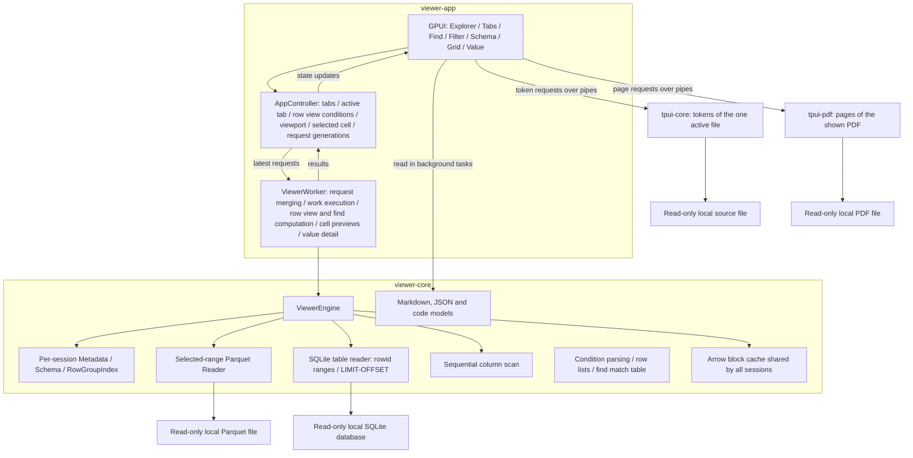

# TPUI Architecture

This document defines component boundaries, state ownership, data contracts and execution. See [usage.md](usage.md) for screens, controls and query syntax, and [README.md](README.md) for build and integration instructions.

## 1. Product scope and technology choices

TPUI is a native desktop viewer that opens local Parquet files and SQLite tables read-only to explore their structure and data and reads Markdown, JSON, JSON Lines and source files and PDF pages, together with the UI components that it shares with other GPUI apps. The viewer consists of the explorer, file opening, tabs, schema view, a grid virtualized over rows and columns, value detail, find, filter, sort and the file and table structure views. The core stack is Rust + GPUI + Arrow/Parquet. A Go process finds the tokens of source files, and a worker process draws PDF pages.

The app shows what the raw data looks like and how the file is stored. Find, filter and sort locate source rows.

Windows x64 comes first. The app opens several files as tabs in a single window and activates one tab at a time. Without filter or sort, data is shown in the source file's row and column order.

| Area | Technology and role |
|---|---|
| Language and build | Rust, Cargo workspace |
| UI | GPUI used directly: windows, input, layout, text and grid rendering |
| Parquet reading | arrow-rs `parquet`: footer, schema, Row Groups, decoding selected rows and columns |
| SQLite reading | `rusqlite` with the bundled SQLite: read-only connections, schema pragmas, range queries in table order |
| Markdown and JSON reading | `pulldown-cmark` for Markdown events; an own JSON and JSON Lines parser that keeps key order, duplicates and number text. See section 11 |
| Source tokens | `tpui-core`, a Go program on the standard library: a one-pass scanner with a rule table per language. See section 11 |
| PDF pages | `tpui-pdf`, a worker process calling `Windows.Data.Pdf` through the `windows` crate. See section 11 |
| Data representation | `arrow-array`, `arrow-schema`: `RecordBatch` and typed column arrays |
| Comparison and sorting | `arrow-ord`: value comparison for find and filter, and sort order |
| Local file access | `std::fs`: read-only file handles and directory listing |
| Data work execution | One dedicated `std::thread` worker running the synchronous Parquet and SQLite readers |
| Result delivery | Bounded `async-channel`; worker results are received in a GPUI task |
| Cache | Byte-budgeted LRU inside the engine; all tabs share one budget |

Find, filter and sort are built on the engine's sequential column scans and Arrow comparison and sort kernels.

GPUI is pinned to an exact commit of a GitHub fork (`GreenWojaKK/zed`) that adds an `image` codec reduction and its change notice on top of a Zed release revision. The fork narrows the `image` features in Zed's root `Cargo.toml` to the gif, jpeg, png and webp that gpui uses directly or for clipboard conversion, and records the difference from upstream in a comment next to the changed lines and in `FORK.md`. GPUI source code is unchanged. Upgrading GPUI means reapplying this change and notice on the new release. The platform crates and Rust toolchain are pinned together, following that revision's Windows examples. `parquet` and the Arrow crates used directly stay on the same arrow-rs release line, and resolved dependencies are pinned in `Cargo.lock`.

## 2. Application state and query processing

### Sources, tabs and screen state

A source is a Parquet path, a SQLite path and table name, or a document path with its kind (`TabSource`). `AppController` deduplicates open sources and assigns a `SessionId` to each new tab. Different tables in the same database are separate sources. Each tab owns its schema view, source identity, file state, row view, center mode, scroll position and selected cell.

The active tab supplies the shared grid, Value panel, structure view and status bar. Switching tabs preserves per-tab state and requests the new active tab's visible range and selected value. Closing a tab releases its session; the next active tab is the one to its right, or the one to its left when there is no right neighbour.

Explorer nodes represent directories, Parquet files, documents, SQLite databases and database objects. Directory and database listings load on expansion. The expanded tree is flattened for virtualized rendering; root generations discard results from a previous root. File dialogs, the command line and explorer activation converge on `open_source` and `open_document`. SQLite detection uses the file header, and a direct database open resolves the first table or view by name.

File and folder dialogs use GPUI's `App::prompt_for_paths`. [Official API](https://docs.rs/gpui/latest/gpui/struct.App.html#method.prompt_for_paths)

### Query model and application

`viewer-core::Query` contains a `ViewSpec` and an optional find value. `ViewSpec` contains a `Filter` and at most one `SortKey`. A filter is an AND of clauses; each clause is an OR of conditions on one column. Comparisons are checked and parsed against that column's Arrow type. The textual grammar and examples are in the [query reference](usage.md#query-text).

`parse_query` returns a complete query or a `QueryError` with a 1-based line, character column and reason. A valid text replaces the active tab's filter, sort and find state; omitted commands clear their corresponding state. A parse failure leaves the current state unchanged. `format_query` serializes the same model, so formatted queries parse back to equivalent conditions, sort and find values.

Context-menu actions update the same `ViewSpec` used by textual queries. New row view work has a request number, target specification and progress. The controller keeps the completed row view visible until the replacement is ready. Cancelling retains the completed view and its conditions. A find submitted with new conditions starts after the corresponding row view has been applied.

### Input adapters

`InputWindow` and `Inbox` are adapters in `viewer-ui` that deliver text to the app. `AppController::apply_message` parses text from either adapter and applies it to the active tab. Immediate mouse actions use GPUI menus.

On Windows, `InputWindow` owns a native multiline edit control on a dedicated thread with its own message loop. The operating system handles IME composition, editing, clipboard and undo. The controller receives submit/close/failure events asynchronously and sends status and text updates without waiting for the window thread. Requests received before window creation are applied after creation. Other platforms use the message-file adapter.

`Inbox` owns one process-specific file in the app's storage directory. The controller polls every 500ms. A changed length/modification-time signature must remain unchanged for a second poll before the text is delivered. The adapter removes a UTF-8 byte order mark, normalizes CRLF line endings and tracks the last delivered signature. The file is removed on shutdown; creation also removes files whose owner processes have exited.

### Query log

`QueryLog` appends one JSON object per recorded query to a daily file in the app's storage directory. Each entry contains local time, source path, SQLite table when present, origin (`click`, `window` or `file`), complete query text, and either the resulting row count or an error.

Queries that start row view work are recorded when that work completes. A superseded computation produces no completion entry; repeated clicks that leave the query unchanged produce no duplicate entry. Parse failures retain the received text and error. The app appends to its own log and message files while source-data access remains read-only. User-facing file locations and controls are in [Query input and log](usage.md#query-input-and-log).

### Files from outside

`open_requests::begin` runs before any window exists. It takes the paths on the command line, made absolute, and tries to create the first instance of a named pipe whose name comes from the app's storage directory, so there is one per user. The process that succeeds is a viewer and keeps a thread listening; the pipe goes away with it, however it ends. A later start with files writes them to the pipe as UTF-16 with a zero after each path and exits without opening a window. A later start without files opens its own window and does not listen. Requests reach `AppController` on a channel and go to `open_path`, and files from a later start bring the window to the front.

The listener makes its next pipe instance before reading the connected one, and a later start retries for up to two seconds while the pipe is between connections, so files opened at the same moment all arrive. Pipe instances accept local clients only.

### Usage log

`UsageMonitor` reads the viewer's memory and CPU, with `GetProcessMemoryInfo` and `GetProcessTimes`, and adds those of `tpui-core` and `tpui-pdf` through their process handles. It appends each reading to a daily file in the app's storage directory (see [usage.md](usage.md#memory-and-cpu-use)). Readings follow events, and the controller's 500ms poll only asks it whether a minute has passed; a reading from that poll is written when a shown value has changed. CPU is the difference of the counted CPU time between two readings over the time between them, relative to the logical processors, so it stays exact however far apart readings are.

Readings change no screen state. The status bar's text changes only when the button is pressed, so usage never causes a redraw by itself. Readings after a tab change or a read are deferred until the update has finished, so what it dropped is gone from the numbers.

## 3. Components and dependencies

The Cargo workspace consists of three crates. The Go module in `core/` builds a separate program, `tpui-core`, and `viewer-app` also builds the PDF worker, `tpui-pdf`.

| Crate | Role | Depends on |
|---|---|---|
| `viewer-core` | Parquet and SQLite reading, row views, find, query text, file and table structure, Markdown, JSON, JSON Lines and code documents, PDF worker messages | arrow-rs, parquet, rusqlite, pulldown-cmark |
| `viewer-ui` | UI components shared by GPUI apps: light and dark themes, context menu, query window of the operating system (Windows), message file, tab bar, tables with fixed or wrapping rows, styled wrapping text, small buttons, line, bar and strip charts, heatmap, route map, number and size formats | GPUI |
| `viewer-app` | The viewer app and the PDF worker. Combines the two crates and owns the worker and screen state | `viewer-core`, `viewer-ui`, GPUI, `windows` |

### Shared theme

`viewer-ui` separates what components do from how they look. Components name the role of each color they draw and the sizes they follow; an app supplies the values.

- `Theme` holds a dark and a light `Palette`, `Metrics` and `Fonts`. Without `theme::install`, the default theme is used.
- Palette roles: background, surface (panels, bars, table headers), overlay (tooltips, menus, popovers), border, text, muted text, missing (null values and missing bars), error, selection, hover, button, button hover, accent, grid line, chart track, scrollbar track and thumb, drop target.
- Metrics hold sizes several components follow together: the fixed table row height, the panel header height (including the tab bar), table cell padding, wrapping row padding and button padding. Geometry of one component stays with that component: tab sizes in the tab bar, bar thickness, track thickness and point size as chart options.
- Fonts: the UI font and the monospace font. The defaults are Segoe UI and Consolas on Windows and DejaVu Sans and DejaVu Sans Mono elsewhere.
- Theme installation is a one-time process initialization. The theme types are `#[non_exhaustive]`, so roles added later do not break consumer apps. Installing after the theme has been read panics because the default theme is already in use. Integration examples are in [README.md](README.md#using-viewer-ui-in-another-app).
- There is one color mode per process. `theme::mode` and `theme::set_mode` switch between the two palettes, and color functions read the mode on every paint. Colors of an app's own views come from `theme::pick(dark, light)`.
- The ring separating overlapping strip-chart points uses `StripChart::background`, which defaults to the surface color.

`viewer-ui` and its consumer apps share one GPUI fork commit, preserving GPUI type identity across crate boundaries. A GPUI revision change therefore coordinates this workspace with its consumers.



| Component | Responsibilities and owned state |
|---|---|
| `AppController` | Tab list and active tab, issuing `SessionId` and `RequestId`, the active tab's latest `RequestId` per viewport, value and find request, error display, theme following |
| Tab state | Per tab: path, `SessionId`, file state, grid scroll position, selected cell, schema expansion, applied row view conditions with their `ViewId` and row count, conditions being built |
| `TabBar` (`viewer-ui`) | Tab titles, active marker, switch, close and reorder input |
| `FindBar` | Value being found, matching cell count and progress, previous and next |
| `Menu` (`viewer-ui`) | Items of an open context menu and their actions |
| `InputWindow` (`viewer-ui`, Windows) | The query window's thread, edit control, status line and requests from the viewer |
| `Inbox` (`viewer-ui`) | The message file of the process and the last version delivered |
| `QueryLog` | The folder of the daily query log files |
| `open_requests` | The thread listening for files from later starts, and the channel to `AppController` |
| `UsageMonitor` | The folder of the daily usage log files, the last reading and the values of the last written line |
| `ViewBar` | The row view's filter and sort conditions as query text with operator boxes and the parentheses of `or` clauses, sweeping conditions into parentheses, query copy, progress and cancel, notices for unsortable columns |
| `StructureView` | The active tab's file structure, the selected Row Group and its column information, or the table structure of a SQLite tab |
| `ExplorerView` | Root path, expanded folders and databases, selected file or table, directory and database listing state |
| `SchemaView` | The active tab's schema nodes and expansion state |
| `GridView` | The active tab's logical scroll position, visible row and column ranges, cell previews and source row numbers, sort and filter marks in headers, input and rendering |
| `ValueView` | Value tree nodes and expansion, selected node, body value and display line index, body scroll position |
| `DocumentView` | The active tab's document, its file's last stamp, the Markdown, JSON, code or PDF view showing it, and the connections to the code core and the PDF worker |
| `MarkdownView` | The parsed document, list state, text selection, the link under the mouse, the document's images |
| `JsonView` | The parsed document, expanded paths, selected path, flattened rows, scroll position |
| `CodeView` | The file's text, scroll position, text selection, the tokens around the screen and the bytes asked for |
| `CodeCore` | The `tpui-core` process, the latest request waiting to be sent, and the threads writing requests and reading answers |
| `PdfView` | Page sizes and their layout at the view's width, scroll position, the drawn page images and the pages asked for |
| `PdfWorker` | The `tpui-pdf` process and its Job Object, the open and draw requests waiting to be sent, and the threads writing requests and reading answers |
| `ViewerWorker` | Handling open and close commands, picking the latest requests, calling the engine, checking result generations, bounded text conversion of Arrow values, holding the selected value and building detail and copy text, holding per-session row lists and mapping row view positions to source rows, row view and find computation tasks |
| `ViewerEngine` | Per open session: file handle, metadata, Row Group index; read planning, decoding, sequential column scans, arbitrary row reads, and the cache shared by all sessions |

Public types of `viewer-core` consist of Rust standard and Arrow types. GPUI's `Entity`, `Context` and `Window` belong to `viewer-app` and `viewer-ui`. The app requests data through the engine's public API, and GPUI layout and paint callbacks only read screen state that is already prepared.

`ViewerWorker` runs the data engine. Explorer directory listings run as separate GPUI background tasks, and in-flight requests for the same folder are merged. When the explorer root changes, responses for the previous root are dropped.

### Charts, heatmaps and maps

Charts and maps in `viewer-ui` are drawn directly as GPUI custom `Element`s.

- `LineChart` takes x and y axes and a list of layers. Layers are bands (`Band`), lines (`Line`) and rules (`Rule`), drawn in insertion order. Prediction intervals are stacked bands, medians and actuals are lines, and nominal values and diagonals are rules.
- `Heatmap` colors row × column cells with a diverging color scale centered at 0, and draws a color scale bar with its bounds on the right.
- `BarChart` draws horizontal bars, one group per row and one bar per series. Bars start at 0 and the scale ends at the largest value unless the caller sets it. Values are written in a column at the right; a missing value leaves a hatched track and the series' missing label. `legend()` builds the series swatches for the caller to place.
- `StripChart` places points on a shared horizontal axis, one row per category, such as the times buses pass a stop. Point labels alternate above and below the track, axis ticks are marked on every track and labeled under the last row, and markers are dashed vertical lines across all rows with an optional label above them. Points outside the axis range are not drawn, and a row without points can show an empty label.
- Bar and strip charts put row labels in a left column at most a fixed share of the width wide, wrapped at spaces. Their height follows their rows: they request a measured layout and compute the row heights from the width they are given.
- Rectangular plot frames, grid lines, guides, point markers, heatmap cells, the color scale, bars, tracks and strip points use `paint_quad`. Bands use `PathBuilder::fill`, joining the upper bound forward and the lower bound backward into a closed path; lines, rules, strip markers and the hatching of missing bars use `PathBuilder::stroke`. Dashes use `dash_array`.
- Bands and lines break at missing points. Points without neighbours are drawn as circles.
- Axis ticks are either given by the caller or placed automatically within the range at 1·2·2.5·5×10ⁿ steps. Automatic tick labels use the fewest decimals that can express the step.
- Text is drawn with `shape_line`, and the plot area is clipped with a content mask so layers do not spill outside the frame.
- On hover, a line chart reports the index of the nearest point, a heatmap the cell's row and column, a bar chart the bar's row and series, and a strip chart the row and index of the point within reach of the mouse. The caller updates its state and passes back the guide or highlight position.
- The caller passes values that are already computed.

`GeoMap` draws background areas, routes, markers and labels at `[latitude, longitude]` coordinates.

- The projection is equirectangular around the center latitude of the fitted region. The view fits the routes, markers and labels with a padding, keeps the aspect ratio and centers them; areas are background and do not affect the fit.
- Areas are filled with `PathBuilder::fill` using the even-odd rule, so holes need no particular winding, and outlined with `PathBuilder::stroke`. Routes are strokes with bevel joins and optional dashes; markers are circles drawn with `paint_quad`; labels are shaped lines with an optional halo drawn as offset copies under the text.
- Area geometry is prepared once per view: areas whose bounds miss the element are skipped, rings are clipped to the element plus a margin (Sutherland–Hodgman), vertices are snapped to the device pixel grid and repeated points are removed. Every area snaps to the same grid, so the shared borders of neighbouring areas stay coincident. The snapping error is at most half a device pixel.
- The tessellated area paths are kept in element state, keyed by the area set (`Arc` identity), the view, the device scale and the border width. Each frame only moves the cached paths to the element's position; colors are applied at paint time, so a theme change reuses the geometry.

### Wrapping text and tables

`WrappedText` wraps only at whitespace and newlines, the way CSS `word-break: keep-all` sets Korean text; no-break spaces join their neighbours, and only a word wider than the whole line is broken between graphemes. It fills its parent's width and requests a measured layout, so its height follows its line count. Line widths are measured with `layout_line`, whose results GPUI caches across frames.

`RichText` wraps by the same rules and draws runs of different fonts, weights, colors and backgrounds. Widths are measured with each run's font, a word wider than a line is split by a search among the graphemes that can fit, and a selection is painted between the backgrounds and the glyphs. It reports the mouse as byte positions of its text. `TextSelection` turns those reports into a selection across the numbered texts of a view: press, drag and release, words and whole texts by click count, and the selected bytes of each text. For code it keeps every space and line, continues long lines on the next line, and draws tabs as spaces up to the next tab stop while reporting positions in the original text.

`table::row` has a fixed height for `uniform_list`, and text that does not fit is truncated and shown in a tooltip. `table::wrapped_row` puts each cell in a `WrappedText`, so a row grows to fit its longest cell; it is for short tables of sentences laid out in an ordinary column. `table::element_header` and `table::element_row` lay out cells the caller draws, such as selectable text. Table functions take column names as `&'static str` or as `SharedString` known only at run time.

### Directory layout

```text
TPUI/
├── README.md
├── architecture.md
├── usage.md
├── Cargo.toml
├── Cargo.lock
├── rust-toolchain.toml
├── core/
│   ├── go.mod
│   ├── main.go
│   └── lex/
│       ├── lex.go
│       └── languages.go
└── crates/
    ├── viewer-app/
    │   ├── Cargo.toml
    │   ├── build.rs
    │   ├── app.rc
    │   ├── assets/
    │   │   ├── app.ico
    │   │   └── logo.png
    │   └── src/
    │       ├── main.rs
    │       ├── app.rs
    │       ├── open_requests.rs
    │       ├── worker.rs
    │       ├── cell_preview.rs
    │       ├── code_core.rs
    │       ├── pdf_worker.rs
    │       ├── value_detail.rs
    │       ├── query_log.rs
    │       ├── usage_log.rs
    │       ├── bin/
    │       │   └── tpui-pdf.rs
    │       └── ui/
    │           ├── code.rs
    │           ├── doc_scrollbar.rs
    │           ├── document.rs
    │           ├── explorer.rs
    │           ├── json_tree.rs
    │           ├── markdown.rs
    │           ├── pdf.rs
    │           ├── schema.rs
    │           ├── grid.rs
    │           ├── value.rs
    │           ├── find_bar.rs
    │           ├── view_bar.rs
    │           ├── structure.rs
    │           └── style.rs
    ├── viewer-ui/
    │   ├── Cargo.toml
    │   ├── src/
    │   │   ├── lib.rs
    │   │   ├── theme.rs
    │   │   ├── tab_bar.rs
    │   │   ├── table.rs
    │   │   ├── widgets.rs
    │   │   ├── wrap.rs
    │   │   ├── chart.rs
    │   │   ├── bars.rs
    │   │   ├── strip.rs
    │   │   ├── heatmap.rs
    │   │   ├── map.rs
    │   │   ├── menu.rs
    │   │   ├── input_window.rs
    │   │   ├── inbox.rs
    │   │   ├── storage.rs
    │   │   └── format.rs
    └── viewer-core/
        ├── Cargo.toml
        ├── src/
        │   ├── lib.rs
        │   ├── model.rs
        │   ├── engine.rs
        │   ├── reader.rs
        │   ├── row_index.rs
        │   ├── cache.rs
        │   ├── code.rs
        │   ├── document.rs
        │   ├── json.rs
        │   ├── markdown.rs
        │   ├── pdf.rs
        │   ├── scan.rs
        │   ├── condition.rs
        │   ├── row_view.rs
        │   ├── query.rs
        │   ├── filter.rs
        │   ├── sqlite.rs
        │   ├── find.rs
        │   ├── structure.rs
        │   └── error.rs
        └── tests/
            ├── document_contract.rs
            ├── reader_contract.rs
            ├── sqlite_contract.rs
            └── view_contract.rs
```

## 4. Engine API and data contracts

The public API is a synchronous Rust API called within the same process. The worker decides when it is called.

| API | Input | Result and behavior |
|---|---|---|
| `open` | `SessionId`, `Path` | Opens a read-only handle and metadata, adds it as a session and returns `DatasetInfo`. Other sessions are kept |
| `open_sqlite` | `SessionId`, `Path`, table name | Opens a read-only connection to the table or view, reads its row count, storage classes and block keys (see section 5), adds it as a session and returns `DatasetInfo` |
| `open_source` | `SessionId`, `DataSource` | Calls `open` or `open_sqlite` |
| `plan_window` | `WindowRequest` | Splits the rows and columns intersected with the file range into `BlockRequest`s per Row Group |
| `read_block` | `BlockRequest`, cancellation state | Looks up the cache or decodes the selected range and returns a `DecodedBlock` |
| `read_value` | `ValueRequest`, cancellation state | Finds the block holding the target cell in the cache or decodes it, and returns a `ValueSlice` holding only that cell |
| `read_rows` | `SessionId`, source row list, column list, cancellation state | Finds each row's block in the cache or decodes it, and returns a `RecordBatch` gathered in row list order |
| `file_structure` | `SessionId` | Returns a `FileStructure` built from metadata alone: file summary, per-Row-Group sizes, and per-leaf-column storage information over all Row Groups |
| `row_group_columns` | `SessionId`, Row Group position | Returns that Row Group's per-leaf-column storage information |
| `table_structure` | `SessionId` | Returns the `TableStructure` of a SQLite session: kind, row order, columns with declared types and storage classes, indexes, `CREATE` statement and database pragmas |
| `scan` | `SessionId`, column list, optional ascending source row list | Returns a sequential column scan, `ColumnScan`. Each call returns the next batch in source order. With a row list, only those rows are read. The cache is not used |
| `close` | `SessionId` | Releases that session's file handle, metadata, index and cache entries |

`DatasetInfo` holds the `SessionId`, `DataSource`, path, file size, total rows, `SchemaRef`, and row count per Row Group; a SQLite table is one group holding all rows. `sqlite_objects(path)` lists the tables and views of a database, and `is_sqlite_file(path)` checks the header. `DecodedBlock` holds the `SessionId`, file-level start row, actual row count, source column IDs and the `RecordBatch`. `ValueSlice` holds the `SessionId`, global row, `ColumnId`, source `Field`, and an Arrow array of length 1 holding the target cell.

The core request types follow this contract:

```rust
pub struct SessionId(pub u64);
pub struct RequestId(pub u64);
pub struct ColumnId(pub usize); // position of a top-level field in the source schema

pub struct WindowRequest {
    pub session: SessionId,
    pub request: RequestId,
    pub rows: std::ops::Range<u64>,
    pub columns: Vec<ColumnId>,
}

pub struct ValueRequest {
    pub session: SessionId,
    pub request: RequestId,
    pub row: u64,
    pub column: ColumnId,
}

pub enum FilterOp { Eq, NotEq, Contains, Lt, LtEq, Gt, GtEq, IsNull, IsNotNull }

pub struct FilterCondition {
    pub column: ColumnId,
    pub op: FilterOp,
    pub value: String, // text typed by the user, parsed as the column type
}

pub struct SortKey {
    pub column: ColumnId,
    pub descending: bool,
}

pub struct ViewSpec {
    pub filter: Filter, // clauses joined by and, each conditions on one column joined by or
    pub sort: Option<SortKey>,
}
```

- Engine row numbers are zero-based and ranges are `[start, end)`. Only on-screen row numbers start at 1.
- Total rows and row positions stay `u64`. Only validated ranges are converted to `usize` for access within a batch.
- Requested columns are sorted into source schema order and deduplicated. Out-of-range column IDs are returned as errors.
- Row ranges are intersected with `[0, total_rows)`. An empty intersection is an empty result with no I/O. `start > end` is a request error.
- A `ValueRequest` row outside `[0, total_rows)` is a request error.
- Column IDs in responses link source fields to positions in the projected batch.
- Requests for sessions that are not open end with `StaleSession`.

## 5. Opening files and reading selected ranges

### Metadata-first open

1. Open the file with `std::fs::File::open`.
2. Read the footer and Parquet metadata and build the Arrow schema.
3. Build cumulative offsets from the row counts per Row Group.
4. Send `DatasetInfo` to the UI to show the schema and file summary.
5. Decode the data blocks needed for the first viewport request.

Metadata is reused for the whole file session. `ParquetRecordBatchReaderBuilder::new_with_metadata` builds a reader from metadata already read. [Official API](https://docs.rs/parquet/latest/parquet/arrow/arrow_reader/type.ParquetRecordBatchReaderBuilder.html#method.new_with_metadata)

### Row Group index

With `G` Row Groups of `n[i]` rows each, build a cumulative array of length `G + 1`.

```text
offsets[0] = 0
offsets[i + 1] = offsets[i] + n[i]
total rows = offsets[G]
```

Global row `r` belongs to the Row Group satisfying `offsets[i] <= r < offsets[i + 1]`. It is found by upper-bound binary search, and the row within the group is `r - offsets[i]`. Row Groups with zero rows are skipped by the same rule. The cumulative sum uses checked arithmetic.

Building the index is `O(G)`, and looking up a single row's group is `O(log G)`.

### Decoding unit

The read unit is **at most 512 rows within one Row Group × the requested set of top-level columns**. Block starts are aligned to 512-row boundaries within the Row Group. The last block is cut at the group's end.

1. Split the requested row range into intervals per Row Group.
2. Select the blocks overlapping each interval, processing blocks that overlap the current viewport first.
3. Select one Row Group with `with_row_groups`.
4. Specify the set of top-level columns with `ProjectionMask::roots`.
5. Specify the block within the group with `RowSelection` skip/select runs and read with `with_batch_size(512)`.
6. The worker builds previews of the cells actually needed and sends them to the UI.

`with_row_groups` is applied before `RowSelection`, so selection row positions are relative to the selected Row Group. [Reader API](https://docs.rs/parquet/latest/parquet/arrow/arrow_reader/struct.ArrowReaderBuilder.html#method.with_row_selection)

Top-level field projection is distinct from leaf projection of nested fields. `ProjectionMask::roots` includes the child columns of the requested top-level fields. [ProjectionMask API](https://docs.rs/parquet/latest/parquet/arrow/struct.ProjectionMask.html#method.roots)

Decompressing and decoding a Parquet page can process more data than the requested rows. Blocks therefore run sequentially, and the cancellation state is checked before and after each batch. Files without a Page Index follow the same read contract.

### Single value lookup

`read_value` picks the block holding the target row with the same rules as block reads.

1. Find a cache entry with the same Row Group and block start that includes the target column.
2. Otherwise, read a block projecting only the target column and insert it into the cache.
3. Copy just the target cell from the block batch into a new array of length 1 and return it as a `ValueSlice`. The returned value does not keep the whole block's buffers alive.

Parquet does not decode part of a single value, so the selected value is fully in memory after decoding. The display cost of large values is bounded by virtualizing display lines in value detail.

### SQLite tables

A SQLite table is addressed like a Parquet file with one Row Group: rows are positions in a fixed row order, and blocks, value reads, row reads, scans, row views and find use the same contracts. Filter, sort and find run the shared Arrow computation over scans of the table, so their rules (Null last, UTF-8 byte order, whole-value matches) are the same for both formats; SQLite's own comparison and collation rules are not used.

- Row order: rowid order for ordinary tables and virtual tables with a rowid, primary key order for `WITHOUT ROWID` tables, and the order SQLite returns for views and other virtual tables. The rowid is reached as `rowid`, `_rowid_` or `oid`, whichever no column shadows.
- Opening runs in one read transaction: one query counts the rows and collects, per column, the storage classes present (`integer`, `real`, `text`, `blob`); for rowid order, a scan of the rowids records the rowid at every 512th row. The transaction ends before the session starts.
- Column types follow the storage classes found: integers only → Int64; reals, or integers and reals → Float64; text only → Utf8; blobs only → Binary; any other mix → Utf8, where integers and reals are written as SQLite-style text and blobs as `x'…'` literals. A column without values takes the type of its declared affinity. The declared type is kept in the field metadata (`sqlite.declared_type`).
- A block in rowid order is `WHERE rowid >= block key ORDER BY rowid LIMIT 512`; other orders use `LIMIT`/`OFFSET`, whose cost grows with the offset. Scans continue from the last rowid read, or by offset. A scan with a row list reads each block holding listed rows once.
- Connections are opened read-only with `query_only`. No transaction is held between reads, so writers are never blocked. Readers of a WAL database update its `-shm` shared-memory file as SQLite requires; the database and WAL files are not written.
- The size and modification time of the database file and its `-wal` file are compared before reads. A change, a row count that no longer matches, or a value whose storage class the column type cannot hold ends the read with `FileChanged`, and the tab offers reopening.

### Storage structure contracts

Parquet structure results use footer metadata and do not decode data pages. They include file-level metadata, Row Group sizes and per-leaf-column storage details. Min/max statistics are converted to Arrow types for comparison and display; truncated statistics retain an approximation marker. Missing statistics and nested leaves have no displayed min/max. Null counts are combined only when every selected Row Group records them.

SQLite structure results combine the session's row count and discovered storage classes with schema pragmas, index information and `CREATE` statements. Opening the SQLite session performs the row inspection described above; requesting its structure does not repeat that scan.

## 6. Virtualized grid

### Viewport computation and rendering

`GridView` stores `first_visible_row: u64` and a pixel offset within that row. Cells are placed in coordinates relative to the viewport. The vertical scrollbar's position ratio is computed in `f64`, and row-wise key input updates the integer row position.

The horizontal position is likewise stored as the first column ID and an offset within that column. The visible column range is computed from the fixed column width. Header and body share the horizontal position, and the row number area stays fixed during horizontal movement.

- 8 rows above and below and 1 column left and right of the viewport are requested as overscan.
- The number of cells built and formatted for the grid is proportional to the viewport plus overscan rows × columns.
- When scrolling or resizing changes the requested range, the latest `WindowRequest` is registered. An unchanged range is not requested again.
- Existing cells overlapping the current screen are kept, and only newly exposed cells show placeholders.
- The grid implements layout, hitboxes and paint as a GPUI custom `Element`. The explorer's and schema's fixed-height row lists use `uniform_list`. [Element API](https://docs.rs/gpui/latest/gpui/trait.Element.html), [uniform_list API](https://docs.rs/gpui/latest/gpui/fn.uniform_list.html)

### Cell display contract

A cell preview is a summary for drawing in the grid, built by the worker. GPUI rendering uses only the preview's text and style. Anything omitted or summarized in a preview is shown in full in value detail.

| Data | Display |
|---|---|
| Null | Dedicated `null` style, distinct from the empty string |
| Boolean, integer, float, Decimal | Value appropriate to the type, keeping the Decimal scale |
| Date, Time, Timestamp | Value and precision kept; Timestamp timezone shown when present |
| String | Preview of at most 256 Unicode scalar values with an ellipsis |
| Binary | Hexadecimal preview of the first 32 bytes and the total byte length |
| Struct | `Struct {field count}` summary |
| List, Map | Element or entry count summary |
| Dictionary | Displayed by the type of the referenced values |
| Types without display support | Type name and a `display unsupported` state |

Strings copy only the prefix they need, and nested values get a summary. Timestamps without timezone information are never converted to an arbitrary local timezone. Decoding errors are handled as data read errors, distinct from unsupported cells.

## 7. Value detail

Grid cells are previews for drawing. Inspecting and copying raw values is the job of value detail, which shows the whole value regardless of length and shape.

### Data flow

1. When the selected cell changes, `AppController` registers a `ValueRequest` under a new `RequestId`.
2. The worker handles the value request after processing the current viewport's blocks. A selected cell within the viewport is found in the cache.
3. The worker keeps the `ValueSlice` returned by `read_value` as the selected value and sends the root node's detail model to the UI.
4. Expanding a nested node makes the UI request its children, addressing the node by its child positions from the root. The worker builds child nodes from the selected value.
5. Selecting a node makes the worker send that node's full raw value to the UI: a text copy for strings, a byte copy for Binary, and the display text for other scalars.

Switching tabs releases the previous tab's selected value. If the new active tab has a selected cell, its value is requested again.

### Value tree and body

| Data | Value tree node | Body |
|---|---|---|
| Null | Dedicated `null` style | Dedicated `null` style, distinct from the empty string |
| Boolean, integer, float, Decimal, Date, Time, Timestamp | Same text as the cell display contract | Same text as the cell display contract |
| String | One-line preview and character count | Full original text |
| Binary | Hexadecimal preview of the beginning and the byte length | Hex dump of all bytes: offset, 16 bytes in hexadecimal and ASCII per line |
| Struct | Child node per field name | Field count summary |
| List | Child node per element position | Element count summary |
| Map | Child node per entry, with key and value nodes under each entry | Entry count summary |
| Dictionary | Node by the type of the referenced values | Body by the type of the referenced values |
| Types without display support | Type name and a `display unsupported` state | Text from `arrow-cast`'s display formatter; if the formatter does not support it either, the type name and a `display unsupported` state |

- Scalar cells show only the body, without a value tree.
- Nodes with more than 1,000 children group them into range nodes of 1,000. Expanding a range node builds only the children in that range.

### Body display

- The body uses a monospace font. String newlines (`\n`, `\r\n`, `\r`) split lines, and tabs and other control characters are shown as display symbols. Lines wider than the panel wrap at the panel width.
- Display symbols and wrapping apply only to the screen. The raw value and copy results are unchanged.
- The UI builds an index of the body's display line starts in a GPUI background task and rebuilds it when the panel width changes. While building the index, the body shows `Loading`.
- The body renders only visible lines with a `uniform_list` of display lines. A hex dump has one line per 16 bytes, so positions are computed from line numbers without an index.

### Copy

With the grid focused, the selected cell's value is copied; with the Value panel focused, the selected node's value. The worker builds the copy text from the selected value and the UI writes it to the clipboard.

| Data | Copy text |
|---|---|
| String | The original text as is |
| Binary | Lowercase hexadecimal without spaces |
| Null | `null` |
| Other scalars | The body text |
| Struct, List, Map | JSON: Struct as an object, List as an array, Map as an array of `{"key": …, "value": …}` objects. Nested Binary as hexadecimal strings, and NaN, Infinity and time values as strings |

Copying a large value builds text as large as the value. Text building runs on the worker and does not block the UI thread.

## 8. Row views and find

### Sequential column scan

`ColumnScan` reads only the requested top-level columns in Row Group order and returns batches of at most 8,192 rows. With an ascending source row list, each Row Group is read with a `RowSelection` holding only those rows, and Row Groups without listed rows are not opened. Each batch is returned with the position in the row list, or in the file, of its first row.

Scans bypass the cache and do not keep the batches they return. The file size and modification time are checked at the start of each Row Group.

### Row lists

A row view is represented by row lists, arrays of source row numbers. When the total row count fits in `u32`, each row uses 4 bytes; otherwise 8 bytes. Without filter or sort, no row list is built.

- Filtered rows: source rows that passed the filter, in ascending order. Built only with a filter.
- Display order: source rows in sorted order. Built only with a sort; it holds all rows with a sort alone, or the filtered rows when there is also a filter.

Row i of the row view is the i-th entry of the display order if it exists, otherwise the i-th filtered row, otherwise the i-th source row.

### Filter computation

1. Parse each condition's value as the column type: string columns use the input as is, Binary as hexadecimal, and other types through `arrow-cast` string conversion. Dictionary columns are parsed as the type of their values.
2. Read only the columns with conditions using a sequential scan.
3. For each batch, build a Boolean result per condition. Comparison and `contains` results are false for Null values; `is null` and `is not null` evaluate validity directly. OR the conditions within each clause, then AND the clauses. Comparisons use `arrow-ord` kernels, and `contains` uses string search.
4. Append the source numbers of true rows to the filtered rows.

### Sort computation

1. Read the sort column with a sequential scan, over the filtered rows if present, otherwise over all rows. Dictionary values are collected as arrays of their referenced values.
2. Concatenate the collected values into one array and run `lexsort_to_indices` keyed by `(sort value, position within the row view)`. The sort value uses the requested direction with Null last, and the position is ascending, so rows with equal values keep source order.
3. Map the resulting positions to source row numbers to build the display order. The sort value array is released when the computation ends.

The number of rows to sort must fit in `u32`. Otherwise the sort is not performed and a notice is shown.

### Reading the screen of a row view

A row view in source order reads the visible range with block reads. With a row list, the worker takes the source row numbers of the visible range, reads them with `read_rows`, and sends the source row numbers to the UI along with the cell previews. `read_rows` also uses the block cache. In a sorted row view, the visible rows are scattered across blocks, so the blocks read for one screen can grow up to the number of visible rows.

Value requests are sent as row view positions, and the worker maps them to source rows before calling `read_value`.

### Find computation

1. Parse the input into a comparison value per column. String columns use the input as is, and Binary columns parse it as hexadecimal. Other scalar columns parse the input as the column type, convert it back to the cell display text, and become comparison targets only when that text equals the input. Each value has exactly one display text, so comparing values equals comparing display texts. Columns without a comparison target are not read.
2. Read the target columns of the row view's rows (the filtered rows if present) with a sequential scan. Mark source rows with matching cells in a bitmap and count the matching cells. The bitmap has 1 bit per source row.
3. For the next or previous match, look first at the following columns in the start cell's row, then scan the bitmap in row view order for a matching row. The found row's target columns are read with `read_rows` to pick the first matching column (the last one for a previous match).

Find results are reused when the session, row view and input are all the same. The worker keeps only the most recent result. To highlight matching cells in the grid, the visible range request carries the find input, and the worker marks matches with the same comparison while building previews.

### Running computation tasks

Row view and find computations run on the data worker thread, split into batches. After each batch, the worker checks the mailbox and handles open, close, visible range and value requests first. Scrolling, cell selection and tab switching therefore keep working during computation, and only one decoding job runs at a time.

- Each session keeps only its latest row view request. A new request, cancel or tab close on the same session drops the in-flight computation. Computations of different sessions run in order.
- Only the active tab's latest find request is kept. If a row view computation remains on the same session, find runs after it.
- Progress is sent to the UI at most once per 100ms.

## 9. Request lifetimes and cache

### File and viewport generations

- Every file opened in a tab gets a new `SessionId`.
- Viewport and value requests come only from the active tab. `RequestId` increments whenever the viewport request changes.
- Value requests take `RequestId`s from the same issuer. The controller keeps the latest `RequestId` for viewports and values separately, and applies a result only when it matches the latest request of the same kind.
- Pending viewport and value requests are each replaced by the latest one. Switching tabs replaces the previous tab's pending requests with those of the new active tab. When the selection changes, node expansion and copy requests and results for the previous value are dropped.
- Close commands are handled before pending opens; opens retain their request order. Closing a tab whose open command has not been processed cancels that command. Responses for closed tabs' sessions are dropped.
- The worker checks generations before reading a block, after decoding a batch, and before sending results.
- Results of cancelled requests are not delivered to the UI. Synchronous I/O already in progress is checked once it returns.
- Blocks completed in the same session can be reused from the cache. The UI applies only results matching the current `SessionId` and `RequestId`.
- Row view requests also take `RequestId`s from the same issuer, and a completed row view is identified by that number. Each tab holds the number of the row view shown in its grid. Viewport, value and find requests carry this number, and the worker drops requests whose number differs from the session's current row view. The UI uses the new number only after receiving the completed row view.
- Row view computation runs per session, so it does not stop on tab switches. Its result is applied only when its number matches the tab's latest row view request.

The request mailbox holds the ordered list of open and close commands, the latest viewport, the latest value request with its node expansion and copy requests, the latest row view request per session, the latest find request and the latest file structure request; wake signals coalesce into a capacity of 1. The worker handles close, open, viewport, value request, node expansion and copy, file structure and find moves in that order, and advances row view or find computation by one batch when there is nothing else to handle. No I/O runs while the mailbox is locked. The result channel holds at most 2 messages and is received asynchronously by a GPUI task in the UI. The UI thread never waits for the worker to finish.

### Cache and memory lifetimes

The cache key is `(SessionId, RowGroupId, block_start, sorted ColumnId list)`. The cache value is the Arrow `RecordBatch` of that projection and its global row position.

There is one cache per engine, and all tabs share the same budget. The LRU evicts by recency regardless of tab, so blocks of tabs not viewed for a while go first. Closing a tab removes that session's cache entries immediately.

| Item | Value |
|---|---|
| Concurrent decoding on the data worker | 1 |
| Row block and output batch size | At most 512 rows |
| Arrow cache budget | 128 MiB total across all tabs |
| Result channel | At most 2 messages |
| Vertical overscan | 8 rows above and below |
| Horizontal overscan | 1 column left and right |
| Selected values held | 1 |
| Value tree range node size | 1,000 children |
| Sequential scan batch size | At most 8,192 rows |
| Row lists | 4 bytes per row; 8 bytes when the total row count exceeds `u32` |
| Find match bitmap | 1 bit per source row; 1 most recent result |
| Progress update interval | At least 100ms |

The cache conservatively counts the actual buffer capacity held by arrays. When a small slice pins a large source buffer, the cost of keeping the source buffer is included. LRU entries are evicted before insertion to fit the budget. A single block larger than the budget is not cached; only the needed previews are built before it is released.

128 MiB is the budget of the retained Arrow cache. The decoder's compression buffers, metadata and UI text use memory separately. In particular, the batch row count does not bound the decoder's internal allocation size, so only one decoder runs at a time. [Reader batch size contract](https://docs.rs/parquet/latest/parquet/arrow/arrow_reader/struct.ArrowReaderBuilder.html#method.with_batch_size)

Grid results carry bounded cell previews, and the UI holds no Arrow batches. Raw values are kept only for the active tab's single selected value: the worker holds the selected value's `ValueSlice`, and the UI holds one copy of the selected node body's text or bytes. This memory is separate from the Arrow cache budget and proportional to the selected value's size. No prefetch runs beyond overscan.

Row lists and the find bitmap use memory proportional to the row count, separate from the Arrow cache budget. With both a filter and a sort, the filtered rows and the display order are both kept. During sort computation, sort values, positions and result arrays for the row view's rows are held together, and the sort values are released when the computation ends. Row lists are released when the tab closes or the row view changes.

Inactive tabs keep only the file handle, metadata, Row Group index, row lists, scroll position, selected cell and schema expansion. Only the active tab has cell previews, so the memory that grows with the number of tabs is per-tab metadata and indexes. Switching tabs releases the previous tab's cell previews and selected value; closing a tab also releases that session's file handle, metadata, index and cache entries.

## 10. State transitions and errors

Without tabs, the app is in the empty state. Each tab's file state transitions `Opening → Ready` or `Opening → OpenError`. Within `Ready`, the grid range and value detail each have `Loading`, `Loaded` and `ReadError`. An error in one tab does not change the state of other tabs.

| Condition | Handling and user action |
|---|---|
| File dialog cancelled | Current state kept |
| Missing path, permission error, invalid Parquet footer, unreadable database or missing table | The tab's `OpenError` shows the path (and table) and reason. Other tabs and opening files keep working |
| File with no data | `Ready`, showing the schema, headers and a zero-row state |
| Decoding failure or unsupported codec in a range | Schema kept; `ReadError` and retry shown for that range |
| Selected value lookup failure | Grid kept; `ReadError` and retry shown in the Value panel |
| Filter value cannot be parsed as the column type | Not applied; reason shown in the filter and sort bar |
| Query text does not parse | Nothing changes; line, column and reason shown in the filter and sort bar and the query window, and logged |
| Message file or query log cannot be read or written | Reason shown in the filter and sort bar |
| Usage log line cannot be written | The usage button's text says `not logged` at the next press; the viewer keeps working |
| Read failure during row view computation | Previous row view kept; reason and `Retry` shown in the filter and sort bar |
| Read failure during find computation | Reason shown in the find bar; recomputed on the next `F3` |
| Document cannot be read, is not UTF-8 or is not valid JSON | Reason shown in the tab with `Retry`; the file stays watched and other tabs keep working |
| Code core missing, ended or failing on a file | Text stays on screen in plain colors; reason shown in the status bar |
| PDF worker missing or ended, or a PDF Windows cannot read | Reason shown in the tab with `Retry`; `Retry` starts a new worker when none runs |
| A PDF page Windows cannot draw | The page stays blank; reason shown at the top of the view |
| Responses for closed tabs' sessions or earlier requests | Dropped |
| Tab closed | That session's pending work cancelled; file handle, metadata, index and cache entries released |
| File size or modification time changed between reads | The tab's cache and grid are invalidated and reopen is offered |
| App exit | Request intake stops, running work is signalled to cancel, all files and caches are released |

File size and modification time are checked on the open handle. The expected usage is that a Parquet or SQLite source is not modified while it is open; documents follow changes to their files (section 11). Errors are distinguished by `viewer-core`'s error type, and user messages are built in `viewer-app`.

## 11. Documents

Markdown, JSON, JSON Lines and source files are read whole, parsed into a model and shown by views of their own. PDF files are read by the PDF worker, which sends their page sizes and drawn pages. They share the tabs, the explorer and the Value panel with the data engine's sources, and `DocumentView` reads them directly in background tasks.

### Reading and lifetime

`read_document(path, kind)` reads a file read-only and returns a `Document`; `document_kind(path)` decides the kind from the extension, and `file_stamp(path)` gives its size and modification time. Text must be UTF-8 (`InvalidText`, with the first invalid byte), and a byte order mark is dropped. A source file holding a NUL byte is also `InvalidText`.

`DocumentView` holds the active tab's document only. Activating a tab reads the file in a GPUI background task, and leaving it drops the document, its views and its images, so memory follows the one document on screen. The tab keeps a `DocumentPosition`: the first block and the offset within it for Markdown, the expanded paths, the selected path and the scroll offset for JSON, or the scroll offsets for code. Paths are child positions from the root, so they stay meaningful across versions of a file.

While a document is shown, the controller's 500ms poll asks `DocumentView` to check its file. The stamp is read in a background task and goes through `ChangeWatch`, which counts a change once the same new stamp is seen twice, so a file caught mid-write or briefly missing during a save is not read. The stamp of a read is taken before the read, so a write landing during it shows as a change afterwards. A reread replaces the document in the existing view and keeps its place; a failed read shows the reason and `Retry`, drops the selected value and keeps watching. Generations drop the results of reads and checks for a previous file.

### Markdown model and view

`MarkdownDocument::parse` runs `pulldown-cmark` with tables, footnotes, strikethrough, task lists, math and metadata blocks, and flattens its events into a list of `MdBlock`s. Containers become fields: a block carries its quote and list depth, and the first block of a list item carries the marker. A table becomes one `TableRow` block per row, sharing alignments and column widths taken from each column's longest text up to a limit. A paragraph holding only images becomes `Image` blocks. Each selectable `MdText` has a number in reading order, its text and its styled spans, so a selection is two `(number, byte)` positions compared as tuples, and `text_between` builds the copy text from them.

`MarkdownView` draws blocks with GPUI's `list` and a `ListState`, which lays out only the blocks on screen plus an overdraw; blocks not yet measured count as a fixed height for the scrollbar. The view keeps the selection and the link under the mouse; `RichText` reports the mouse as byte positions. Images go through a `RetainAllImageCache` owned by the view and dropped with it. An image at a web address shows its alt text and address.

### JSON model and view

`JsonDocument::parse` is an iterative RFC 8259 parser that keeps the file's text and one record per value: its kind, the byte spans of its key and value, and the range of its children in a shared array. Key order, duplicate keys and number text therefore come from the file itself. Strings are decoded when asked for, and `string_preview` decodes only the beginning of a long one. Parsing keeps its open containers in a list, so depth is limited by memory only. Files are limited to 4 GiB by the 32-bit offsets. Failures report a byte, a line, a character column and a reason (`InvalidJson`).

`JsonView` flattens the expanded tree into rows for `uniform_list`, grouping more than `GROUP_SIZE` children into range rows as the value tree does. Selecting a row sends a `ValueDetail` without children to the Value panel: the decoded text for strings, the file's text for other scalars, a count for arrays and objects. Copying a node gives its decoded text, or for other kinds its bytes in the file.

`JsonDocument::parse_lines` reads a JSON Lines file with the same parser, one `\n`-separated line at a time, as the children of a root array whose text is the whole file. Blank lines are skipped. A table beside the nodes holds each child's file line number and the reason for each failed line. A failed line's partial nodes are dropped, and one `Invalid` node over its text takes its place, so a bad line costs only itself. Only a file over 4 GiB fails as a whole. `JsonView` names the root `file`, numbers its children by line, shows a line's text in the file on its row, and writes places as `line 12: $.a`.

### Code view

`CodeDocument` keeps the file's text whole with the start of each line and the width of the widest line. Lines break at `\n`, `\r\n` and `\r`, and a final line break starts an empty last line. Selections are `(line, byte)` positions, and copying takes the bytes between them, so the clipboard holds the file's own line breaks.

`CodeView` draws through a custom element. Every line has one height and stays on one row, so the scroll position alone gives the lines on screen, and only those are shaped. A line is shaped up to `MAX_DRAWN_LINE_BYTES` with a note of what is left. The scroll range follows the widest drawn line.

The text is on screen before any token exists. During layout the view compares the bytes on screen with the tokens it holds and the bytes already asked for; when neither covers them it emits `NeedTokens` for the lines on screen plus `TOKEN_MARGIN_LINES` on each side. A token crossing lines, such as a block comment, colors each line it touches. A token that does not fit the text is left out, and `style::token_color` turns its kind into a color.

### Code core

`core/` is a Go module on the standard library. `build.rs` runs `go build` with `CGO_ENABLED=0` and puts `tpui-core` next to the viewer's executable; a failed build gives a Cargo warning.

The viewer and the core exchange one JSON object per line over stdin and stdout.

| Message | Fields |
|---|---|
| Request | `id`, `path`, `stamp` (`len`, `modified` in nanoseconds since the Unix epoch), `start`, `end` |
| Tokens | `id`, `language` (empty for a file without rules), `tokens` as a flat list of start, length and kind |
| Stale | `id`, `stale`: the file on disk is not the version asked for |
| Failure | `id`, `error`: this request failed and the core keeps running |

Token kinds are 1 comment, 2 string, 3 number, 4 keyword, 5 constant, 6 type, 7 function and 8 attribute. Byte positions count from after a byte order mark.

The core holds one `activeFile`: its path, stamp, language and a `lex.Table` of parallel start, length and kind arrays in file order. It builds the table when a request names another file or stamp, in memory only, and answers a range by binary search. It checks the file's stamp before and after reading, so the text it scans is the version the viewer holds or the answer says `stale`. Files over `maxLexBytes` get no tokens.

`lex.Lex` makes one pass in linear time and keeps only the previous token as context. A `Language` is data: comment markers, a `stringRule` per opening quote, keyword tables, the words that define a name, and optional hooks for what the table cannot say, such as Rust's raw strings and JavaScript's regular expressions and templates. A name right after a definer takes the definer's kind, a name before `(` is a function, or a type when capitalized in languages that say so, other capitalized names are types and all-capitals names constants except in Go, where case marks exported names, and a name after an adjacent `.` is never a keyword. `Detect` chooses the language from the extension.

Requests never wait in a queue. `CodeCore` keeps only the latest unsent request and the core keeps only the latest unanswered one, and `DocumentView` drops every answer but the one to its latest request. The UI thread only sets a slot and receives on a channel.

`DocumentView` starts the core at the first token request and ends it when a tab other than code is shown. The core starts no other process. It ends when stdin closes, so it ends with the viewer however the viewer ends. When it ends unexpectedly, the next request starts it again, up to `MAX_CORE_STARTS` times per opened file. A stale answer holds further requests until the file's next read, or until the file is back at the version on screen.

### PDF view

`document_kind` gives `Pdf` for the `.pdf` extension. `DocumentView` reads a PDF's stamp in a background task, starts the PDF worker if none runs, and asks it to open the file; the worker's `Info` finishes the read with the page sizes, and its `Failed` finishes it with the reason. The stamp and `ChangeWatch` work as for other documents, and a reread asks the worker to open the file again.

`PdfView` lays the pages one under another at the view's width, up to `PDF_MAX_PAGE_WIDTH`, with each page's height from its size in the file. The tab's `PdfScroll` is a page and the fraction of it at the top of the view, so the place survives a new width. During layout the view asks for the pages on screen plus one on each side that it has not drawn at the current pixel width, emitting `Draw` with that width, and drops the images of other pages with `drop_image`, which also frees their atlas tiles. A page arriving for another document, width or a page no longer wanted is dropped. Releasing the view drops all its images.

### PDF worker

`tpui-pdf` is a second binary of `viewer-app`, so the build puts it next to the viewer's executable. It runs `Windows.Data.Pdf`: `StorageFile::GetFileFromPathAsync`, `PdfDocument::LoadFromFileAsync`, page sizes in device-independent pixels, and `RenderWithOptionsToStreamAsync` to a BMP at a destination width. The engine's output is wider than the width asked for by a factor it learns from each result and carries to the next request, and the worker converts the bottom-up BMP to top-down BGRA.

The viewer and the worker exchange framed messages over stdin and stdout: a little-endian 32-bit length, then a tag byte and the fields.

| Message | Fields |
|---|---|
| `Open` | `doc`, `path` |
| `Draw` | `doc`, the pixel width, the page numbers |
| `Info` | `doc`, the width and height of each page |
| `Page` | `doc`, `page`, the width asked for, the image's width and height and its BGRA bytes |
| `Failed` | `doc`, the page when a page failed or none when the open failed, the reason |

A reader thread in the worker keeps only the latest `Open` and the latest `Draw`, and a new `Open` drops a waiting `Draw`. The worker skips a `Draw` for a document other than the one it opened last, and stops a batch of pages when new work arrives. It opens the PDF file for a metadata read or a batch of pages and closes it afterwards, because the engine may map the file while it is open and another program could then not rewrite it in place. `DocumentView` numbers each open with `doc` and drops replies for earlier numbers.

`DocumentView` starts the worker when a PDF tab is read and ends it when a tab other than PDF is shown or the view is cleared, so it runs while a PDF is on screen and stays between PDF tabs. `PdfWorker` creates the process with `CreateProcessW` inside a Job Object with `JOB_OBJECT_LIMIT_KILL_ON_JOB_CLOSE`, assigned at creation through `PROC_THREAD_ATTRIBUTE_JOB_LIST`, with an inherited-handle list holding only the child's ends of the two pipes, without a console window and with stderr discarded. Dropping `PdfWorker` closes the job handle, which ends the worker; when the viewer ends in any way the system closes the handle and ends it as well. The worker also exits when its stdin closes. When the worker ends unexpectedly, a pending read finishes with that reason and a shown PDF tab shows it with `Retry`, which starts a new worker.
