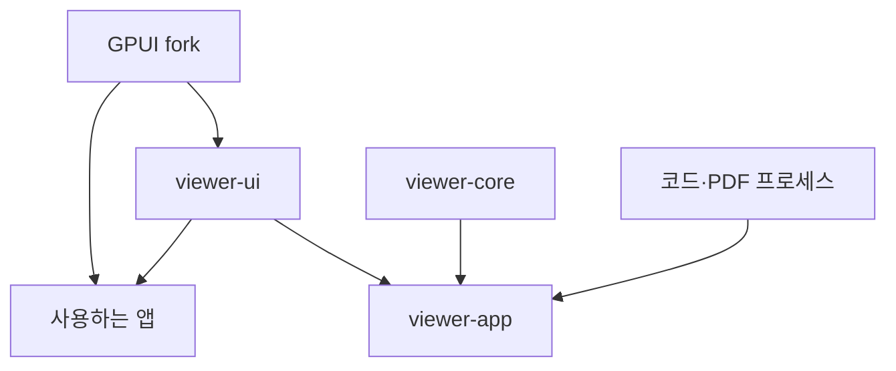

# TPUI 아키텍처

[English](../../architecture.md) | 한국어

TPUI는 GPUI fork와 재사용할 UI 컴포넌트로 구성된다. 앱은 컴포넌트에 표시할 데이터와 상호작용 상태를 소유한다. 함께 제공하는 viewer는 이 컴포넌트를 파일 리더와 문서 뷰에 연결한다.

## 컴포넌트와 책임

| 컴포넌트 | 책임 |
|---|---|
| GPUI fork | 창, 레이아웃, 텍스트, 렌더링 |
| [viewer-ui](../../crates/viewer-ui/src/lib.rs) | 공용 컴포넌트와 테마 |
| [viewer-core](../../crates/viewer-core/src/lib.rs) | Rust·Arrow 타입을 사용하는 파일 읽기, 문서 모델, 테이블 질의 |
| [viewer-app](../../crates/viewer-app/src/app.rs) | Viewer 상태, 상호작용, 백그라운드 작업 |
| [tpui-core](../../core/main.go) / [tpui-pdf](../../crates/viewer-app/src/bin/tpui-pdf.rs) | Viewer의 코드 토큰 / PDF 페이지 렌더링 |



앱과 `viewer-ui`는 타입을 공유하도록 같은 GPUI revision을 사용한다. 의존성 설정은 [README](README.md#앱에서-viewer-ui-사용하기)에 있다.

## 공용 UI 컴포넌트

### 테마와 상태

테마를 변경하려면 컴포넌트가 처음 읽기 전에 설치한다. 컴포넌트는 색을 역할별로 읽고 글꼴·공통 치수를 테마에서 가져온다. 실행 중 밝은 모드와 어두운 모드를 전환할 수 있다.

앱은 선택·hover 상태를 소유해 컴포넌트에 전달하고, 컴포넌트는 상호작용 이벤트를 앱에 보고한다.

### 텍스트와 표

줄바꿈 텍스트는 공백과 줄 끝에서 끊고, 한 줄보다 긴 단어는 grapheme 사이에서 나눈다. 스타일 텍스트와 선택은 원본 텍스트의 byte 위치를 사용하므로, 표시 방식이 바뀌어도 복사와 편집기 이동에 사용하는 위치를 유지한다.

고정 높이 행은 가상화 목록에 사용한다. 줄바꿈 행은 내용에 맞춰 높이가 늘어난다.

인터페이스는 [wrap.rs](../../crates/viewer-ui/src/wrap.rs)와 [table.rs](../../crates/viewer-ui/src/table.rs)에 있다.

### 차트와 지도

차트는 계산된 값을 받고 마우스 아래의 점·셀·계열을 보고한다. 앱은 상태를 갱신하고 강조할 대상을 전달한다. 누락된 값에서 선과 밴드는 끊어지며, 막대 차트는 누락된 값과 0을 구분해 표시한다.

지도는 `[latitude, longitude]` 좌표와 표시 영역의 중심 위도를 기준으로 하는 정거원통도법을 사용한다. 경로·marker·레이블이 맞춤 범위를 결정하며 배경 영역은 범위에 포함하지 않는다.

차트·지도 인터페이스는 [viewer-ui](../../crates/viewer-ui/src/lib.rs)에서 제공한다.

## Viewer 앱

### 파일과 탐색

[AppController](../../crates/viewer-app/src/app.rs)는 탭을 소유하고 이벤트를 데이터 엔진이나 문서 뷰에 연결한다. 소스는 문서 경로, Parquet 경로 또는 SQLite 경로와 테이블 이름이다. 같은 소스를 다시 열면 기존 탭을 활성화한다.

각 탭은 탐색 위치를 유지한다. 데이터 탭은 선택한 셀·스키마 펼침·행 뷰를, JSON 탭은 펼친 값과 선택한 경로를 함께 유지한다. 활성 소스에 따라 본문과 보조 패널을 표시한다.

파일 선택창, 명령줄, 탐색기는 같은 열기 경로를 사용한다. 문서 확장자로 문서 종류를 정하고 SQLite 파일은 헤더로 판별한다. 그 밖에 직접 연 파일은 Parquet 리더로 처리한다.

### 테이블 데이터

[ViewerEngine](../../crates/viewer-core/src/engine.rs)은 Parquet 파일과 SQLite 연결을 읽기 전용으로 연다. Parquet은 메타데이터를 먼저 읽고 화면에 필요한 행·컬럼 범위를 디코딩한다. SQLite는 열 때 저장된 값을 조사해 컬럼 타입과 행 위치를 정한다. 일반 테이블은 rowid 순서, `WITHOUT ROWID` 테이블은 기본 키 순서, 뷰는 SQLite가 반환하는 순서를 사용한다.

SQLite 컬럼은 저장된 storage class에 따라 Arrow 타입을 정한다. 하나의 숫자·바이너리 타입으로 표현할 수 없는 혼합 값은 텍스트로 표시한다. 요청 사이에는 읽기 transaction을 유지하지 않는다. SQLite는 WAL 데이터베이스를 읽는 과정에서 공유 메모리 파일을 갱신할 수 있다.

엔진은 0부터 시작하는 `u64` 행 번호와 반열린 구간을 사용하며 화면 행 번호는 1부터 시작한다. 범위는 소스 안으로 제한하고 빈 범위는 I/O를 수행하지 않는다. 역전된 범위, 잘못된 컬럼, 범위를 벗어난 단일 값 요청은 오류다. 컬럼 projection은 최상위 필드를 지정하며 중첩된 자식 필드를 포함한다.

Worker는 디코딩한 데이터를 길이가 제한된 셀 미리보기로 변환한다. 셀을 선택하면 전체 값을 요청하며, 선택한 값은 원본 블록에서 분리해 블록 전체를 유지하지 않도록 한다. 중첩 값은 요청할 때 펼친다. 화면 형식이 바뀌어도 복사에 사용하는 원본 값은 유지한다.

필터와 정렬은 원본 행 번호 목록을 만든다. 그리드는 이 목록을 따라 이동하면서 원본 행 번호를 표시한다. 두 형식은 같은 Arrow 기반 비교를 사용한다. 새 행 뷰는 계산이 완료되면 적용하며, 취소하거나 실패하면 완료된 뷰를 유지한다. 찾기는 완료된 뷰를 대상으로 실행한다. 정렬 대상이 4,294,967,295행을 넘으면 알림을 표시하고 정렬하지 않는다.

질의 parser와 UI 메뉴는 같은 모델을 갱신한다. 텍스트는 필터·정렬·찾기 전체 상태를 지정하고 파싱 오류가 나면 기존 상태를 유지한다. 문법과 비교 동작은 [사용 안내](usage.md#질의-텍스트)에 있다. 질의 파싱은 [query.rs](../../crates/viewer-core/src/query.rs), 행 매핑은 [row_view.rs](../../crates/viewer-core/src/row_view.rs)에서 처리한다.

### 문서

[DocumentView](../../crates/viewer-app/src/ui/document.rs)는 활성 문서를 불러오고 다른 탭을 표시하면 내용을 해제한다. 텍스트 문서는 전체를 읽고 화면에 보이는 범위에 맞춰 표시 작업을 수행한다.

| 형식 | 모델과 화면 |
|---|---|
| Markdown | 파싱한 블록과 스타일 텍스트. 선택·편집기 이동에 사용할 원본 위치 보유 |
| JSON / JSON Lines | 키 순서·중복 키·숫자 표기를 보존하는 트리. 잘못된 JSON Lines 줄은 개별 오류 행으로 유지 |
| 코드 | 소스 텍스트와 줄 위치. `tpui-core`가 토큰 제공 |
| PDF | Windows의 `tpui-pdf`가 페이지 크기와 이미지 제공 |

파일 크기와 수정 시각이 안정되면 변경을 반영한다. 새 문서로 내용을 교체하고 읽던 위치를 복원한다. JSON은 새 트리의 자식 위치로 경로를 찾는다. 읽기 실패 시 이유와 `Retry`를 표시하며 파일 확인을 계속한다.

코드 프로세스는 소스 텍스트에서 토큰을 계산한다. 코드 탭이 활성 상태인 동안 실행하며 실패하면 구문 색상 없이 텍스트를 표시한다. PDF 프로세스는 PDF 탭이 활성 상태인 동안 화면 주변 페이지를 렌더링한다. PDF worker가 실패하면 `Retry`를 제공한다. 두 프로세스는 viewer와의 연결이 끝나면 종료한다.

### 실행과 메모리

데이터 worker는 디코딩을 한 번에 하나씩 수행하고 스캔을 배치 단위로 진행하며, 화면 읽기와 값 요청을 우선 처리한다. 문서는 background task에서 읽고 코드·PDF 작업은 별도 프로세스에서 실행한다.

세션과 요청 번호로 결과를 식별한다. 새 요청은 대기 중인 이전 작업을 대체하고, 닫힌 탭이나 이전 요청의 결과는 폐기한다. 결과는 해당 요청을 보낸 행 뷰나 문서 버전에만 적용한다.

모든 데이터 탭은 byte 예산이 있는 캐시를 공유한다. UI는 미리보기와 활성 선택 값을 보유하며, 캐시는 유지하는 Arrow buffer를 계산한다. 큰 개별 값, decoder buffer, 필터 행 목록과 정렬 배열은 캐시 예산 밖의 메모리를 사용한다. 텍스트 문서의 메모리는 활성 파일 크기에 따라 늘어난다.

Parquet이나 SQLite 소스가 바뀌면 데이터 화면을 무효화하고 다시 열어야 한다. 탭을 닫으면 해당 세션과 대기 작업을 해제한다. Worker의 스케줄링과 소유권은 [worker.rs](../../crates/viewer-app/src/worker.rs)에 있다.

### 외부 연동

Windows는 네이티브 질의 창을 제공한다. 메시지 파일은 외부 프로그램의 같은 질의 텍스트를 전달하며 Linux의 입력 경로로도 사용한다. 두 경로는 `AppController::apply_message`로 연결하고 적용한 질의와 파싱 오류를 질의 로그에 기록한다.

Markdown·코드 뷰는 선택이나 클릭을 원본 위치에 대응시킨다. Controller는 파일과 위치를 사용자의 편집기에 넘기고, 문서 변경 감시가 저장된 결과를 다시 읽는다. 편집기 선택은 [사용 안내](usage.md#편집기에서-열기)에 설명한다.

Windows에서는 명령줄 파일을 수신 중인 viewer에 전달한다. Linux에서는 새 프로세스에서 연다. PDF 렌더링과 프로세스 사용량 측정은 Windows 서비스를 사용한다.

플랫폼 연동은 [editor.rs](../../crates/viewer-app/src/editor.rs), [open_requests.rs](../../crates/viewer-app/src/open_requests.rs), [input_window.rs](../../crates/viewer-ui/src/input_window.rs), [inbox.rs](../../crates/viewer-ui/src/inbox.rs)에 있다.

## 검증

엔진 변경은 선택 범위, 중첩 값, Null, 행 뷰, 파일 변경을 포함한 작은 Parquet·SQLite fixture로 확인한다. 탐색으로 원본 파일은 변경되지 않는다. 계약 테스트는 [viewer-core/tests](../../crates/viewer-core/tests)에 있다.

저장소 루트에서 실행한다.

```text
cargo fmt --all
cargo clippy --workspace --all-targets
cargo test --workspace
```
